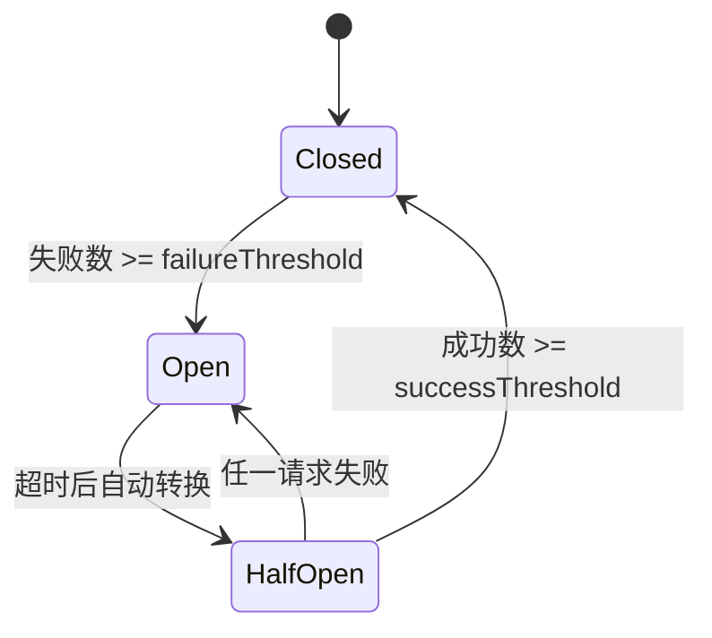
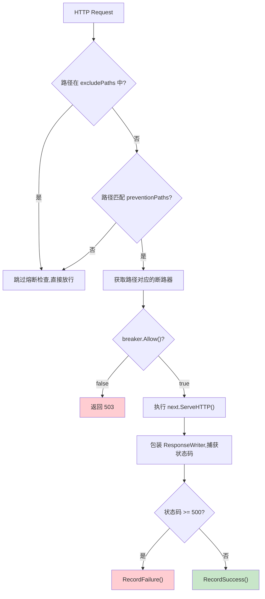
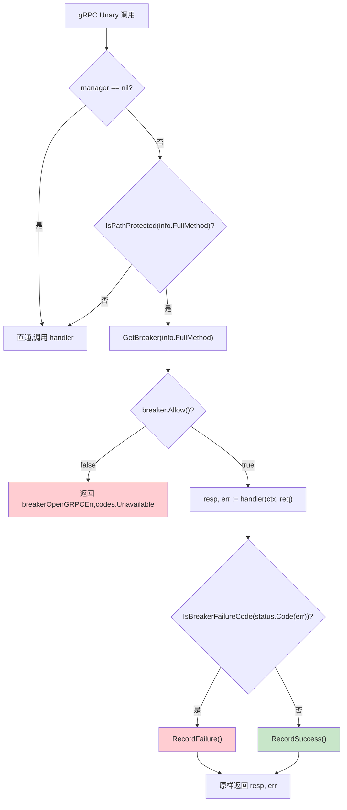

# 熔断器

## 概述

`middleware` 包提供独立的熔断器实现，包含核心断路器逻辑、多实例管理器，以及 HTTP 中间件与 gRPC 拦截器两套适配层。配置管理下沉到 `go-config`（`breakerconfig.CircuitBreaker`），核心业务逻辑由此模块维护。

HTTP 与 gRPC 共用同一个 `Breaker` 状态机和同一个 `BreakerManager` 实例，差别只有熔断 key 的来源：HTTP 用 `r.URL.Path`，gRPC 用 `info.FullMethod`。

> 源码：[middleware/breaker.go](../middleware/breaker.go)

## 状态机

断路器有三种状态：



| 状态 | 常量 | 行为 |
|------|------|------|
| `BreakerClosed` | `"closed"` | 正常工作，允许所有请求，累计失败数 |
| `BreakerOpen` | `"open"` | 拒绝所有请求，等待超时后转为 HalfOpen |
| `BreakerHalfOpen` | `"half_open"` | 允许部分请求，成功数达到阈值则转 Closed，任一失败则转 Open |

`BreakerState` 类型定义为 `type BreakerState string`，上述三个常量为其可选值。

## Breaker — 核心断路器

> 源码：[middleware/breaker.go:Breaker](../middleware/breaker.go#L44)

```go
type Breaker struct {
    mu                sync.Mutex
    state             atomic.Value  // BreakerState
    failureThreshold  int           // 失败阈值
    successThreshold  int           // 半开→关闭的成功阈值
    timeout           time.Duration // Open→HalfOpen 超时
    volumeThreshold   int           // 最小请求量（低于此值不触发熔断）
    failureCount      atomic.Int32  // 连续失败计数
    successCount      atomic.Int32  // 半开状态连续成功计数
    totalRequests     atomic.Int64
    failedRequests    atomic.Int64
    lastFailureTime   time.Time     // mu 保护，仅 Open 超时判断读取
    lastStateChangeAt time.Time     // mu 保护
}
```

状态用 `atomic.Value` 存储，计数字段用 `atomic.Int32/Int64`，热路径（`Allow` / `RecordSuccess` / `RecordFailure`）完全无锁；`mu` 只保护状态转换这一类复合操作（`lastFailureTime`、`lastStateChangeAt` 与转换的原子性）：

- `Allow()`：非 `Open` 状态直接返回 `true`，只有 `Open` 状态才加锁检查 `time.Since(lastFailureTime) > timeout` 并转为 `HalfOpen`
- `RecordSuccess()`：`Closed` 状态只把 `failureCount` 原子清零；`HalfOpen` 才加锁累加 `successCount`，达到 `successThreshold` 转 `Closed`
- `RecordFailure()`：`Closed` 状态先原子累加 `failureCount`，只有同时满足 `failureCount >= failureThreshold` 且 `totalRequests >= volumeThreshold` 才加锁转 `Open`（加锁后 double-check）；`HalfOpen` 下任一失败立即转回 `Open`

### 创建

> 源码：[breaker.go:NewBreaker()](../middleware/breaker.go#L60)

```go
breaker := middleware.NewBreaker(
    5,                // failureThreshold: 连续 5 次失败触发熔断
    3,                // successThreshold: 半开状态连续 3 次成功恢复
    10,               // volumeThreshold: 至少 10 次请求才开始计算
    30*time.Second,   // timeout: 熔断 30 秒后尝试恢复
)
```

### 核心方法

| 方法 | 说明 | 源码 |
|------|------|------|
| `Allow() bool` | 检查是否允许请求通过 | [breaker.go:L82](../middleware/breaker.go#L82) |
| `RecordSuccess()` | 记录成功 | [breaker.go:L107](../middleware/breaker.go#L107) |
| `RecordFailure()` | 记录失败 | [breaker.go:L129](../middleware/breaker.go#L129) |
| `GetState() BreakerState` | 获取当前状态 | [breaker.go:L199](../middleware/breaker.go#L199) |
| `GetStats() BreakerSnapshot` | 获取统计信息（等价于 `Snapshot()`） | [breaker.go:L204](../middleware/breaker.go#L204) |
| `Snapshot() BreakerSnapshot` | 获取强类型快照（用于指标采集） | [breaker.go:L218](../middleware/breaker.go#L218) |
| `Reset()` | 重置断路器 | [breaker.go:L229](../middleware/breaker.go#L229) |

### BreakerSnapshot — 强类型快照

> 源码：[middleware/breaker.go:BreakerSnapshot](../middleware/breaker.go#L209)

`GetStats()` 返回强类型 `BreakerSnapshot`，避免 `map[string]any` 的反射开销，便于指标采集：

```go
type BreakerSnapshot struct {
    State          BreakerState
    TotalRequests  int64
    FailedRequests int64
    FailureCount   int32
    SuccessCount   int32
}
```

### 使用示例

```go
breaker := middleware.NewBreaker(5, 3, 10, 30*time.Second)

if !breaker.Allow() {
    return errors.NewError(errors.ErrCodeCircuitBreakerOpen, "service unavailable")
}

result, err := callExternalService()
if err != nil {
    breaker.RecordFailure()
    return err
}
breaker.RecordSuccess()
return result, nil
```

### 统计信息

```go
stats := breaker.GetStats()
// stats 类型为 BreakerSnapshot：
// stats.State          = BreakerClosed
// stats.TotalRequests  = 150
// stats.FailedRequests = 3
// stats.FailureCount   = 0
// stats.SuccessCount   = 0
```

## BreakerManager — 断路器管理器

> 源码：[middleware/breaker.go:BreakerManager](../middleware/breaker.go#L250)

管理多个断路器实例，每个路径一个独立断路器。直接持有 `go-config` 的 `breakerconfig.CircuitBreaker` 配置对象。

```go
type BreakerManager struct {
    mu             sync.RWMutex
    breakers       map[string]*Breaker
    config         *breakerconfig.CircuitBreaker // go-config 断路器配置
    excludePathSet map[string]struct{}           // 排除路径集合，O(1) 查找替代线性扫描
}
```

### 创建

> 源码：[breaker.go:NewBreakerManager()](../middleware/breaker.go#L258)

直接接收 `go-config` 配置对象；传 `nil` 时自动使用 `breakerconfig.Default()`：

```go
import (
    "github.com/kamalyes/go-rpc-gateway/middleware"
    breakerconfig "github.com/kamalyes/go-rpc-gateway/config/breaker"
)

cfg := &breakerconfig.CircuitBreaker{
    Enabled:          true,
    FailureThreshold: 5,
    SuccessThreshold: 3,
    VolumeThreshold:  10,
    Timeout:          int64(30 * time.Second), // 纳秒
    PreventionPaths:  []string{"/api/v1/external/"}, // 需要保护的路径前缀
    ExcludePaths:     []string{"/api/v1/health"},    // 排除的路径
}
manager := middleware.NewBreakerManager(cfg)
```

### 核心方法

| 方法 | 说明 | 源码 |
|------|------|------|
| `GetBreaker(path) *Breaker` | 获取或创建路径断路器（double-check lock） | [breaker.go:L273](../middleware/breaker.go#L273) |
| `GetAllBreakers() map[string]*Breaker` | 获取所有断路器 | [breaker.go:L301](../middleware/breaker.go#L301) |
| `GetAllBreakerSnapshots() map[string]BreakerSnapshot` | 获取所有断路器的强类型快照（用于指标采集） | [breaker.go:L313](../middleware/breaker.go#L313) |
| `GetStats() map[string]BreakerSnapshot` | 获取所有断路器统计（等价于 `GetAllBreakerSnapshots`，兼容旧 API） | [breaker.go:L354](../middleware/breaker.go#L354) |
| `ResetBreaker(path) bool` | 重置指定路径断路器 | [breaker.go:L325](../middleware/breaker.go#L325) |
| `ResetAllBreakers()` | 重置所有断路器 | [breaker.go:L339](../middleware/breaker.go#L339) |
| `IsPathProtected(path) bool` | 检查路径是否需要保护（排除路径 O(1) map 查找，保护路径前缀匹配） | [breaker.go:L359](../middleware/breaker.go#L359) |
| `CountByState() BreakerHealthStatus` | 单次遍历统计各状态断路器数量 | [breaker.go:L385](../middleware/breaker.go#L385) |
| `GetHealthStatus() BreakerHealthStatus` | 获取健康状态（返回强类型结构体，单次遍历） | [breaker.go:L420](../middleware/breaker.go#L420) |

### BreakerHealthStatus — 健康状态

> 源码：[middleware/breaker.go:BreakerHealthStatus](../middleware/breaker.go#L376)

`GetHealthStatus()` 返回强类型 `BreakerHealthStatus`，替代旧的 `map[string]any`：

```go
type BreakerHealthStatus struct {
    Total    int  // 断路器总数
    Open     int  // 打开数量
    HalfOpen int  // 半开数量
    Closed   int  // 关闭数量
    Healthy  bool // 是否健康（无打开的断路器）
}
```

```go
status := manager.GetHealthStatus()
// status.Total    = 5
// status.Open     = 0
// status.HalfOpen = 1
// status.Closed   = 4
// status.Healthy  = true
```

### 计数方法

以下方法均委托 `CountByState()` 单次遍历得到结果（替代三次独立遍历）：

| 方法 | 说明 | 源码 |
|------|------|------|
| `CountOpenBreakers() int` | Open 状态数量 | [breaker.go:L405](../middleware/breaker.go#L405) |
| `CountHalfOpenBreakers() int` | HalfOpen 状态数量 | [breaker.go:L410](../middleware/breaker.go#L410) |
| `CountClosedBreakers() int` | Closed 状态数量 | [breaker.go:L415](../middleware/breaker.go#L415) |

## BreakerHTTPMiddleware — HTTP 中间件

> 源码：[middleware/breaker.go:BreakerHTTPMiddleware()](../middleware/breaker.go#L430)

```go
func BreakerHTTPMiddleware(manager *BreakerManager) func(http.Handler) http.Handler
```

为 HTTP 处理器提供断路器保护：

```go
manager := middleware.NewBreakerManager(cfg)

// 应用中间件
handler := middleware.BreakerHTTPMiddleware(manager)(nextHandler)
```

执行流程：



熔断时的响应（使用预分配的响应体，零分配）：

```json
{
    "code": 503,
    "message": "Service temporarily unavailable (circuit breaker open)",
    "success": false
}
```

## gRPC 拦截器

> 源码：[middleware/breaker.go:UnaryServerBreakerInterceptor()](../middleware/breaker.go#L563)、[breaker.go:StreamServerBreakerInterceptor()](../middleware/breaker.go#L597)

```go
func UnaryServerBreakerInterceptor(manager *BreakerManager) grpc.UnaryServerInterceptor
func StreamServerBreakerInterceptor(manager *BreakerManager) grpc.StreamServerInterceptor
```

两个拦截器复用与 HTTP 完全相同的 `Breaker` 状态机和 `BreakerManager` 实例，不另起一套统计，因此指标采集（`GetAllBreakerSnapshots`）只有一份数据源。两侧的差异只有这些：

| 维度 | HTTP `BreakerHTTPMiddleware` | gRPC `UnaryServerBreakerInterceptor` / `StreamServerBreakerInterceptor` |
|------|------------------------------|--------------------------------------------------------------------------|
| 熔断 key | `r.URL.Path` | `info.FullMethod`，形如 `/user.v1.UserService/GetUser` |
| 保护判断 | `IsPathProtected(r.URL.Path)` | `IsPathProtected(info.FullMethod)` |
| 拒绝返回 | 503 + 预分配 JSON body `breakerOpenResp` | 预构建的 `codes.Unavailable` status error `breakerOpenGRPCErr` |
| 失败判定 | `ResponseWriter.IsServerError()`，即状态码 >= 500 | `IsBreakerFailureCode(status.Code(err))` |
| 计数粒度 | 一次请求 | Unary 一次调用；Stream 一条流 |
| `manager == nil` | 不适用（由 `Manager` 保证非 nil） | 直通放行，不创建断路器 |

### 配置：prevention-paths 必须写 gRPC 全限定方法名

`IsPathProtected` 对 `prevention-paths` 做前缀匹配、对 `exclude-paths` 做 O(1) map 精确查找。gRPC 的 key 是 `/包名.服务名/方法名`，与 HTTP 的 `/api/v1/...` 不在同一命名空间——**HTTP 的 prevention-paths 不会命中任何 gRPC 方法**，必须显式配置：

```yaml
middleware:
  circuit-breaker:
    enabled: true
    failure-threshold: 5
    success-threshold: 3
    volume-threshold: 10
    timeout: 30000000000             # 纳秒（30 秒）
    prevention-paths:
      - "/api/v1/external/"          # HTTP 路径前缀
      - "/user.v1.UserService/"      # 前缀匹配：保护该 gRPC 服务的全部方法
      - "/order.v1.OrderService/Pay" # 也可以只保护单个方法
    exclude-paths:
      - "/api/v1/health"
      - "/user.v1.UserService/Health" # 精确匹配，不做前缀匹配
```

断路器按 key 隔离：`/user.v1.UserService/GetUser` 被熔断不影响 `/user.v1.UserService/ListUsers`。未命中 `prevention-paths`、或命中 `exclude-paths` 的方法直通放行，且**不会创建断路器实例**。

### 失败判定表

> 源码：[breaker.go:IsBreakerFailureCode()](../middleware/breaker.go#L522)

```go
func IsBreakerFailureCode(code codes.Code) bool
```

判定只看客户端最终收到的 status code，即 `status.Code(err)`（`err == nil` 时为 `codes.OK`）。只有下游真的坏了才计入失败，否则客户端自己的错误会把健康的下游熔断掉：

| gRPC code | 计入失败 | 理由 |
|-----------|----------|------|
| `OK` | 否 | 正常响应 |
| `Canceled` | 否 | 调用方主动取消，下游还活着 |
| `Unknown` | **是** | handler panic 或返回了非 status 错误，客户端看到的就是 500 |
| `InvalidArgument` | 否 | 客户端参数错误 |
| `DeadlineExceeded` | **是** | 下游超时，熔断器存在的首要信号 |
| `NotFound` | 否 | 资源不存在 |
| `AlreadyExists` | 否 | 资源已存在 |
| `PermissionDenied` | 否 | 鉴权失败，与下游健康度无关 |
| `ResourceExhausted` | 否 | 限流/配额背压，见下方取舍 |
| `FailedPrecondition` | 否 | 业务前置条件不满足 |
| `Aborted` | 否 | 并发冲突，上层重试即可 |
| `OutOfRange` | 否 | 参数越界 |
| `Unimplemented` | 否 | 确定性契约错误，见下方取舍 |
| `Internal` | **是** | 下游内部错误 |
| `Unavailable` | **是** | 下游不可用，最典型的熔断场景 |
| `DataLoss` | **是** | 不可恢复的数据损坏 |
| `Unauthenticated` | 否 | 未认证 |

计入失败的集合 `{Unknown, DeadlineExceeded, Internal, Unavailable, DataLoss}` 正好对应 HTTP 5xx，与 HTTP 中间件的 `IsServerError()`（状态码 >= 500）判定一致。三点需要记住的取舍：

- **`ResourceExhausted` 不计入**：它既是本仓库限流拦截器的拒绝码（`middleware/ratelimit.go` 返回 `codes.ResourceExhausted`），也是下游配额背压的常用码。若计入，就会出现「流量高峰 → 限流拒绝 → 熔断打开 → 下游明明健康却全量拒绝」的正反馈
- **`Unimplemented` 不计入**：这是对「5xx 即故障」的一处**有意偏离**（grpc-gateway 把它映射为 HTTP 501）。方法不存在是确定性的契约错误，重试永远失败，熔断只会把信息量更大的 `Unimplemented` 换成笼统的 `Unavailable`，掩盖版本/部署不一致。另外 grpc-go 对未注册的方法在进入拦截器链之前就返回 `Unimplemented`，能走到这里的只有 handler 自己显式返回的那种
- **service 必须调用 `.ToGRPCError()`**：若直接 `return errors.NewError(errors.ErrCodeBadRequest, ...)` 而不转换，gRPC 对外给出的是 `Unknown`，这里也就按 `Unknown` 记为失败——判定与客户端视角保持一致，同时让这种用法问题暴露出来

### 熔断拒绝时返回的错误

> 源码：[breaker.go:breakerOpenGRPCErr](../middleware/breaker.go#L486)

```go
var breakerOpenGRPCErr = errors.NewError(errors.ErrCodeCircuitBreakerOpen, "").ToGRPCError()
```

- 走仓库统一错误码体系，而不是裸 `status.Errorf`：`ErrCodeCircuitBreakerOpen(4003)` → `commonapis.StatusCode_Unavailable` → `codes.Unavailable`，消息是错误码的标准消息 `Circuit breaker open`（三态映射见 [ERRORS.md](./ERRORS.md)）
- 与 HTTP 侧语义一致：同一个错误码的 HTTP 映射就是 503，两侧对客户端表达的是同一件事
- 不走 `errors.ToGRPCError(ctx, bizCode)` 这条 i18n 路径：那个包级函数是给各微服务注册的**业务**错误码用的（`errors/biz.go`），熔断拒绝是框架层决策，没有业务 bizCode，也不该在熔断期间为每个被拒绝的请求再付一次翻译查表
- 在包级 `var` 预构建一次，与 HTTP 侧预分配的 `breakerOpenResp` 同理：被拒绝的请求零分配
- 拒绝时不打日志：状态转换本身已在 `transitionToLocked` 里记了 WARN/INFO，熔断打开期间每个被拒绝的请求再打一条只会刷屏
- 被拒绝的请求不进入统计：没有触达 `RecordSuccess` / `RecordFailure`，`TotalRequests` 不增长

### 执行流程（Unary）



Stream 拦截器流程完全相同，只是把 `handler(ctx, req)` 换成 `handler(srv, ss)`，并且不读取 `ss`（只用 `info.FullMethod`）。

### Stream 的计数粒度

- 建流时 `Allow()` 检查一次，流结束（`handler` 返回）时按返回的 status code 记一次结果
- 与限流 Stream 拦截器「建流时限流一次」的粒度保持一致
- 长连接流在结束之前不贡献统计——这是刻意取舍：流内每条消息都记一次，会让单条异常长流主导整个方法的熔断统计

### 拦截器链位置

> 源码：[server/grpc.go](../server/grpc.go)

熔断拦截器挂在**限流之后、struct tag 校验之前**，Unary 与 Stream 两条链一致：

```text
Unary :  tracing → request-context → logging → i18n → metrics → ratelimit → breaker → struct-tag-validator → compression
Stream:  tracing → request-context → logging → ratelimit → breaker → struct-tag-validator → i18n → compression
```

三条理由：

1. **必须在限流之后**：限流拒绝返回 `ResourceExhausted`，若熔断在外层，这种自我保护的拒绝会被熔断器当成下游响应观测到；放在内层后熔断器永远看不到限流拒绝，从链路结构上消除「流量高峰 → 限流拒绝 → 熔断打开」的正反馈（判定表里排除 `ResourceExhausted` 是第二道防线）。限流也是更便宜的检查，先把过载流量丢掉可以让熔断器连 map 查找和原子计数都省掉
2. **必须在校验之前**：熔断打开时的全部价值就是 fail fast，不该再为注定被拒绝的请求付反射校验的代价
3. **必须尽量贴近 handler**：熔断统计要反映 handler 的真实健康度，中间夹的层越少越好。这里唯一夹在中间的 struct tag 校验返回 `InvalidArgument`，已在判定表中被归为客户端问题，不会污染统计

### 通过 Manager 使用

> 源码：[manager.go:GRPCBreakerUnaryInterceptor()](../middleware/manager.go#L311)、[manager.go:GRPCBreakerStreamInterceptor()](../middleware/manager.go#L321)

```go
func (m *Manager) GRPCBreakerUnaryInterceptor() grpc.UnaryServerInterceptor
func (m *Manager) GRPCBreakerStreamInterceptor() grpc.StreamServerInterceptor
```

两个访问器都在 `middleware.circuit-breaker.enabled=false` 或 `breakerManager == nil` 时返回 `nil`，调用方据此跳过挂载（与 `GRPCRateLimitUnaryInterceptor` 等访问器的约定一致）：

```go
if breakerInterceptor := mgr.GRPCBreakerUnaryInterceptor(); breakerInterceptor != nil {
    unaryInterceptors = append(unaryInterceptors, breakerInterceptor)
}
```

返回的拦截器持有 `NewManager` 中创建的同一个 `breakerManager`，与 `BreakerMiddleware()`（HTTP）、`GetBreakerManager()`（指标采集）共享状态。

直接构造（不经 `Manager`）：

```go
manager := middleware.NewBreakerManager(cfg)

grpcServer := grpc.NewServer(
    grpc.ChainUnaryInterceptor(middleware.UnaryServerBreakerInterceptor(manager)),
    grpc.ChainStreamInterceptor(middleware.StreamServerBreakerInterceptor(manager)),
)
```

## 配置

熔断器配置通过 `go-config` 的 `breakerconfig.CircuitBreaker` 提供，YAML 中位于 `middleware.circuit-breaker`：

```yaml
middleware:
  circuit-breaker:
    enabled: true
    failure-threshold: 5
    success-threshold: 3
    volume-threshold: 10
    timeout: 30000000000  # 纳秒（30 秒）
    prevention-paths:
      - "/api/v1/external/"
    exclude-paths:
      - "/api/v1/health"
```

> `timeout` 字段为 `int64` 纳秒值，运行时通过 `time.Duration(m.config.Timeout)` 转换。

> `prevention-paths` / `exclude-paths` 同时作用于 HTTP 路径与 gRPC 全限定方法名，gRPC 方法需按 `/包名.服务名/方法名` 形式单独配置，详见上文 [gRPC 拦截器](#grpc-拦截器)。

## 下一步

- [中间件系统](./MIDDLEWARE.md) — 了解所有中间件
- [错误体系](./ERRORS.md) — 了解熔断器使用的错误码
