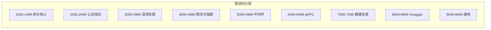
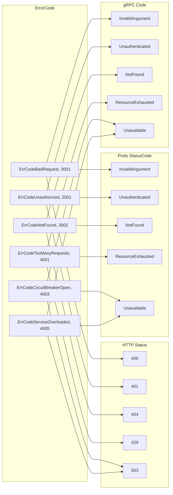

# 错误体系

## 概述

`errors` 包提供统一的错误定义和管理，包含错误码体系、`AppError` 结构体、三态映射（ErrorCode → HTTP Status / gRPC StatusCode / Proto StatusCode）和格式化工具。

> 源码目录：[errors/](../errors/)

## ErrorCode — 错误码

> 源码：[errors/code.go](../errors/code.go)

`ErrorCode` 基于 `int` 类型，按业务域分段：



| 范围 | 域 | 示例 |
|------|-----|------|
| 1000–1999 | 网关核心 | `ErrCodeGatewayNotInitialized(1001)`、`ErrCodeGatewayTimeout(1005)` |
| 1100–1199 | 配置与特性 | `ErrCodeFeatureNotRegistered(1102)`、`ErrCodeGRPCServerInitFailed(1106)` |
| 1200–1299 | 服务器与基础设施 | `ErrCodeServerCreationFailed(1201)` |
| 2000–2999 | 认证授权 | `ErrCodeUnauthorized(2001)`、`ErrCodeTokenExpired(2004)` |
| 2100–2199 | JWT | `ErrCodeTokenMalformed(2101)`、`ErrCodeTokenNotValidYet(2102)` |
| 3000–3999 | 请求处理 | `ErrCodeBadRequest(3001)`、`ErrCodeNotFound(3002)` |
| 3100–3199 | 初始化 | `ErrCodeInitializationError(3105)` |
| 4000–4999 | 限流、降载与熔断 | `ErrCodeTooManyRequests(4001)`、`ErrCodeCircuitBreakerOpen(4003)`、`ErrCodeServiceOverloaded(4005)` |
| 5000–5999 | 中间件 | `ErrCodeMiddlewareError(5001)`、`ErrCodeSignatureInvalid(5007)` |
| 5100–5199 | 国际化 | `ErrCodeLanguageLoadFailed(5101)` |
| 6000–6999 | gRPC | `ErrCodeGRPCConnectionFailed(6001)`、`ErrCodeGRPCTimeout(6004)` |
| 7000–7999 | 健康检查 | `ErrCodeHealthCheckFailed(7001)` |
| 8000–8999 | Swagger | `ErrCodeSwaggerNotFound(8001)` |
| 9000–9999 | 通用 | `ErrCodeUnknown(9000)`、`ErrCodeConflict(9004)` |

## AppError — 应用错误

> 源码：[errors/error.go:AppError](../errors/error.go)

```go
type AppError struct {
    Code    ErrorCode
    Message string
    Details string
}
```

### 创建

```go
// 只给错误码，消息取自码表
err := errors.NewError(errors.ErrCodeUnauthorized)

// 构造时用选项给详情
err := errors.NewError(errors.ErrCodeBadRequest, errors.WithDetails("invalid user ID"))
err := errors.NewError(errors.ErrCodeNotFound, errors.WithDetailsf("user %s not found", userID))

// 例外口子：覆盖码表给出的消息（码表是单一来源，这不是常规写法）
err := errors.NewError(errors.ErrCodeBadRequest, errors.WithMessage("用户 ID 不合法"))

// 格式化创建（等价于 NewError + WithDetailsf）
err := errors.NewErrorf(errors.ErrCodeNotFound, "user %s not found", userID)

// 拿到之后再补：同名的链式方法
err := errors.NewError(errors.ErrCodeUnauthorized).
    WithDetails("token expired at 2025-01-01")
```

> `details` 从必填形参改成了选项：原先 72 处预定义错误变量全写成 `NewError(code, "")`，
> 那个空串不表达任何信息。选项名与 `AppError` 的链式方法同名 —— 方法在类型的命名空间、
> 包级函数在包的命名空间，Go 允许重名，一个名字一个含义比起 `WithDetail` 差一个字母要好记。
>
> 源码：[error.go:NewError()](../errors/error.go)、[error.go:NewErrorf()](../errors/error.go)、[error.go:WithDetails()](../errors/error.go)

### 包装标准错误

```go
// 自动识别：如果 err 已经是 *AppError，直接返回
appErr := errors.Wrap(stdErr, errors.ErrCodeInternalServerError)

// 包装并添加额外信息
appErr := errors.Wrapf(stdErr, errors.ErrCodeGRPCConnectionFailed, "service %s", "user-service")
```

> 源码：[error.go:Wrap()](../errors/error.go)、[error.go:Wrapf()](../errors/error.go)

### 字段访问与错误接口

`AppError` 实现了 `error` 与 `fmt.Stringer` 接口，并提供字段访问器：

```go
// 实现 error 接口：[code] message 或 [code] message: details
err.Error()

// 实现 Stringer 接口，等价于 Error()
err.String()

// 字段访问器
appErr.GetCode()      // ErrorCode
appErr.GetMessage()   // 标准消息（来自 errorMessages 映射）
appErr.GetDetails()   // 错误详情（可为空）
```

> 源码：[error.go:Error()](../errors/error.go)、[error.go:String()](../errors/error.go)、[error.go:GetCode()](../errors/error.go)、[error.go:GetMessage()](../errors/error.go)、[error.go:GetDetails()](../errors/error.go)

### 三态映射

每个 `ErrorCode` 自动映射到三种状态码：



| 映射 | 方法 | 源码 |
|------|------|------|
| HTTP Status | `appErr.GetHTTPStatus()` | [error.go](../errors/error.go) |
| Proto StatusCode | `appErr.GetStatusCode()` | [error.go](../errors/error.go) |
| gRPC codes | `appErr.ToGRPCError()` | [error.go](../errors/error.go) |

映射示例：

| ErrorCode | HTTP Status | Proto StatusCode | gRPC Code |
|-----------|-------------|------------------|-----------|
| `ErrCodeBadRequest(3001)` | 400 | `InvalidArgument` | `InvalidArgument` |
| `ErrCodeUnauthorized(2001)` | 401 | `Unauthenticated` | `Unauthenticated` |
| `ErrCodeNotFound(3002)` | 404 | `NotFound` | `NotFound` |
| `ErrCodeTooManyRequests(4001)` | 429 | `ResourceExhausted` | `ResourceExhausted` |
| `ErrCodeCircuitBreakerOpen(4003)` | 503 | `Unavailable` | `Unavailable` |
| `ErrCodeServiceOverloaded(4005)` | 503 | `Unavailable` | `Unavailable` |

### 转换为 Result

```go
result := appErr.ToResult()
// result.Code   = 400  (HTTP Status)
// result.Error  = "invalid user ID" (Details 优先，否则 Message)
// result.Status = StatusCode_InvalidArgument
```

> 源码：[error.go:ToResult()](../errors/error.go)

### 转换为 gRPC Error

```go
grpcErr := appErr.ToGRPCError()
// 返回 status.Error(codes.InvalidArgument, "Bad request: invalid user ID")
```

> 源码：[error.go:ToGRPCError()](../errors/error.go)

内部将 `commonapis.StatusCode` 转换为标准 `google.golang.org/grpc/codes`：

```go
switch statusCode {
case commonapis.StatusCode_InvalidArgument:
    code = codes.InvalidArgument
case commonapis.StatusCode_Unauthenticated:
    code = codes.Unauthenticated
// ... 完整映射
}
```

### 判断与提取

```go
// 判断错误码是否匹配
if errors.IsErrorCode(err, errors.ErrCodeNotFound) {
    // 处理 404
}

// 从任意 error 提取 ErrorCode
code := errors.GetErrorCode(err) // 如果不是 AppError，返回 ErrCodeUnknown

// 获取错误代码对应的标准消息字符串（未知则返回 "Unknown error"）
msg := errors.ErrorCodeString(errors.ErrCodeNotFound) // "Not found"
```

> 源码：[error.go:IsErrorCode()](../errors/error.go)、[error.go:GetErrorCode()](../errors/error.go)、[error.go:ErrorCodeString()](../errors/error.go)

## Formatter — 格式化工具

> 源码：[errors/formatter.go](../errors/formatter.go)

提供常用消息格式化函数，统一错误消息风格：

```go
// 初始化错误
msg := errors.FormatInitError("Redis", err)
// "初始化Redis失败: connection refused"

// 启动错误
msg := errors.FormatStartupError("gRPC server", err)
// "启动gRPC server失败: address already in use"

// 配置错误
msg := errors.FormatConfigError("加载签名密钥", err)

// 连接信息
msg := errors.FormatConnectionInfo("gRPC", "localhost:9000")
// "🌐 gRPC端点: localhost:9000"

// 关闭信息
msg := errors.FormatShutdownInfo("SIGTERM")
// " 🛑 收到信号 SIGTERM，开始优雅关闭..."
```

| 函数 | 用途 | 源码 |
|------|------|------|
| `FormatInitError(component, err)` | 初始化失败 | [formatter.go](../errors/formatter.go) |
| `FormatStartupError(service, err)` | 启动失败 | [formatter.go](../errors/formatter.go) |
| `FormatConfigError(operation, err)` | 配置操作失败 | [formatter.go](../errors/formatter.go) |
| `FormatConnectionInfo(service, endpoint)` | 连接信息 | [formatter.go](../errors/formatter.go) |
| `FormatShutdownInfo(signal)` | 关闭信号 | [formatter.go](../errors/formatter.go) |
| `FormatPanicError(operation, err)` | Panic 错误 | [formatter.go](../errors/formatter.go) |

## 业务错误码与国际化（biz.go）

> 源码：[errors/biz.go](../errors/biz.go)

`biz.go` 提供业务错误码到 gRPC 状态码的可注册映射，以及基于 i18n 的错误消息解析。各微服务在 bootstrap 阶段注册自己的映射规则，运行时自动查找。

### 注册与映射

```go
// 推荐：gRPC 码与网关码一起注册，二者是一个决定的两面
errors.RegisterMany(map[string]errors.CodeMapping{
    "error.user_not_found":     {codes.NotFound, errors.ErrCodeNotFound},
    "error.order_status_error": {codes.FailedPrecondition, errors.ErrCodeBadRequest},
})
errors.Register("error.payment_failed", errors.CodeMapping{codes.Internal, errors.ErrCodeInternalServerError})

// 只给 gRPC 码时，网关码按 gRPC 码推导（不会留零值——零值是 ErrCodeOK，
// 会让一个错误在响应包络里显示成成功）
errors.RegisterBizCode("error.payment_failed", codes.Internal)
errors.RegisterBizCodeMap(map[string]codes.Code{"error.user_not_found": codes.NotFound})

// 运行时查找：显式注册 → _not_found 后缀 → 兜底 Internal
errors.Mapping("error.user_not_found")               // {NotFound, ErrCodeNotFound}
errors.MapBizCodeToGRPCCode("error.user_not_found")  // codes.NotFound
errors.MapBizCodeToGatewayCode("error.user_not_found")
```

> ⚠️ 除 `_not_found` 结尾的码之外必须显式注册：其余一律兜底 `Internal`，
> 漏登记的 `_already_exists` 会变成 500 而不是 409，且没有任何报错提示。
>
> 注册表带读写锁：注册在 bootstrap 期、查找在每个请求的错误路径上，而 Go 对并发读写 map 是直接 fatal。
>
> 另有 15 个通用码的具名构造器（`errors.NotFound(ctx)` 等）与链式构造器
> （`errors.Of(code).With(...).Cause(err).Err(ctx)`），见 [errors/README.md](../errors/README.md)。
>
> 源码：[biz.go:Register()](../errors/biz.go)、[biz.go:RegisterMany()](../errors/biz.go)、[biz.go:Mapping()](../errors/biz.go)、[chain.go](../errors/chain.go)

### 转换为 gRPC Error（包级函数）

> 注意：`biz.go` 中的 `ToGRPCError` 是**包级函数**（接收 `context` 与业务码），与 `AppError.ToGRPCError()` 方法不同。

```go
// 通过 i18n 键获取消息并构建标准 gRPC 错误
err := errors.ToGRPCError(ctx, "user_not_found")

// 支持模板变量替换（例如 error.hello → "你好 {name}"）
err := errors.ToGRPCErrorWithTemplate(ctx, "error.hello", map[string]interface{}{
    "name": "张三",
})
```

> 源码：[biz.go:ToGRPCError()](../errors/biz.go)、[biz.go:ToGRPCErrorWithTemplate()](../errors/biz.go)

### i18n 消息与错误串解析

```go
// 获取国际化消息字符串
// 解析顺序：服务 locales → 本包内置文案（builtin_messages.go）→ 错误码本身
// 中间那层保证没写 locales 的新服务也不会把 "error.not_found" 这种标识符返给前端
msg := errors.NewI18nError(ctx, errors.BizErrCodeNotFound)

// 获取带模板变量的国际化消息字符串
msg := errors.NewI18nErrorWithTemplate(ctx, "error.hello", map[string]interface{}{
    "name": "张三",
})

// 收 error：取链上最内层 gRPC status 的 Message
// 用标准库的 stderrors.As 而不是 status.FromError —— 后者遇到 %w 包裹的 status 时会把外层 error 的
// 完整文案覆盖进 Message，提取结果就带上了 "rpc error: code = ..." 信封
msg := errors.ExtractRpcErrorMsg(rpcErr)

// 收字符串：从网关包络 {code,msg} 里取 msg；不是 JSON 则返回原串
msg := errors.ExtractEnvelopeMsg(raw)
```

> 两个函数名字相近、输入不同：`ExtractRpcErrorMsg` 收 `error`，`ExtractEnvelopeMsg` 收字符串。
>
> 源码：[biz.go:NewI18nError()](../errors/biz.go)、[biz.go:ExtractRpcErrorMsg()](../errors/biz.go)、[biz.go:ExtractEnvelopeMsg()](../errors/biz.go)

## 完整示例

### Service 层使用

```go
func (s *UserService) GetUser(ctx context.Context, req *pb.GetUserRequest) (*pb.GetUserResponse, error) {
    if req.Id == "" {
        return nil, errors.NewError(errors.ErrCodeMissingParameter,
            errors.WithDetails("user ID is required")).ToGRPCError()
    }

    user, err := s.repo.FindByID(req.Id)
    if err != nil {
        return nil, errors.Wrapf(err, errors.ErrCodeInternalServerError, "find user %s", req.Id).
            ToGRPCError()
    }
    if user == nil {
        return nil, errors.NewErrorf(errors.ErrCodeNotFound, "user %s not found", req.Id).
            ToGRPCError()
    }

    return &pb.GetUserResponse{User: user.ToProto()}, nil
}
```

### HTTP Handler 使用

```go
func (h *Handler) CreateUser(w http.ResponseWriter, r *http.Request) {
    var req CreateUserRequest
    if err := json.NewDecoder(r.Body).Decode(&req); err != nil {
        response.WriteAppErrorf(w, errors.ErrCodeBadRequest, "invalid request body: %v", err)
        return
    }

    if err := h.service.CreateUser(r.Context(), &req); err != nil {
        if appErr, ok := err.(*errors.AppError); ok {
            response.WriteAppError(w, appErr)
        } else {
            response.WriteInternalServerErrorResult(w, "internal error")
        }
    }

    response.WriteSuccessResult(w, "user created")
}
```

## 下一步

- [HTTP 响应工具](./RESPONSE.md) — 了解 AppError 如何被写入 HTTP 响应
- [熔断器](./BREAKER.md) — 了解熔断器如何使用错误码
