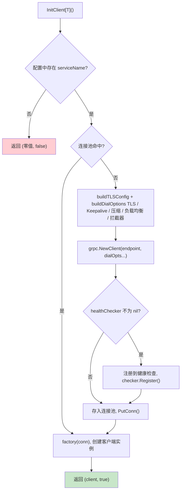

# gRPC 客户端

## 概述

`cpool/grpc` 包提供泛型辅助函数 `InitClient`，用于快速初始化 gRPC 客户端连接，支持健康检查、TLS、负载均衡等特性。

> 源码目录：[cpool/grpc/](../cpool/grpc/)

## 客户端初始化流程



## InitClient 泛型辅助

> 源码：[cpool/grpc/client.go](../cpool/grpc/client.go)

```go
func InitClient[T any](
    healthChecker *HealthChecker,
    clients map[string]*gwconfig.GRPCClient,
    serviceName string,
    factory func(grpc.ClientConnInterface) T,
) (T, bool)
```

### 参数说明

| 参数 | 类型 | 说明 |
|------|------|------|
| healthChecker | `*HealthChecker` | 健康检查管理器（可选，传 nil） |
| clients | `map[string]*gwconfig.GRPCClient` | gRPC 客户端配置（从 Gateway 配置获取） |
| serviceName | `string` | 目标服务名称（对应配置文件中的 key） |
| factory | `func(grpc.ClientConnInterface) T` | 客户端工厂函数（如 `pb.NewXxxServiceClient`） |

返回值：`(客户端实例, 是否成功)`

## InitClientTo 便捷封装

> 源码：[cpool/grpc/client.go](../cpool/grpc/client.go)

`InitClientTo` 是 `InitClient` 的便捷封装，成功时将客户端赋值到 `*target` 并记录 Info 日志，失败时记录 Warn 日志，减少调用方样板代码。

```go
func InitClientTo[T any](
    healthChecker *HealthChecker,
    clients map[string]*gwconfig.GRPCClient,
    serviceName, label string,
    factory func(grpc.ClientConnInterface) T,
    target *T,
) bool
```

```go
grpcpool.InitClientTo(g.healthChecker, clients, "user-service", "UserService",
    userpb.NewUserServiceClient, &g.userClient)
```

## InitClientAny 反射调用入口

> 源码：[cpool/grpc/client.go](../cpool/grpc/client.go)

`InitClientAny` 与 `InitClient` 逻辑相同，但工厂函数和返回值均为 `interface{}`，便于自动注册场景下的反射调用。

```go
func InitClientAny(
    healthChecker *HealthChecker,
    clients map[string]*gwconfig.GRPCClient,
    serviceName string,
    factory func(grpc.ClientConnInterface) interface{},
) (interface{}, bool)
```

## BuildDialOptions 构建拨号选项

> 源码：[cpool/grpc/client.go](../cpool/grpc/client.go)

公开方法，根据客户端配置构建完整的 `[]grpc.DialOption`，包括 TLS、keepalive、消息大小、HTTP/2 窗口、压缩、负载均衡与拦截器链。

```go
func BuildDialOptions(clientCfg *gwconfig.GRPCClient, serviceName string, healthChecker *HealthChecker) []grpc.DialOption
```

## 连接池辅助函数

> 源码：[cpool/grpc/client.go](../cpool/grpc/client.go)

`InitClient` 内部维护按服务名缓存 `*grpc.ClientConn` 的全局连接池，重复初始化同一服务会复用已有连接。以下函数提供池的直接访问：

| 函数 | 签名 | 说明 |
|------|------|------|
| `GetConn` | `func(serviceName string) (*grpc.ClientConn, bool)` | 从连接池获取指定服务的连接 |
| `PutConn` | `func(serviceName string, conn *grpc.ClientConn)` | 将连接存入连接池 |
| `BuildEndpointMap` | `func(clients map[string]*gwconfig.GRPCClient) map[string]string` | 从配置构建服务名到首端点的映射 |

```go
endpoints := grpcpool.BuildEndpointMap(clients)
g.healthChecker.StartPeriodicCheck(grpcpool.DefaultHealthCheckInterval, endpoints)
```

`DefaultHealthCheckInterval` 为包级常量，值为 `3 * time.Second`。

## 基础用法

### 无健康检查

```go
func (g *MyGateway) setupGRPCClients() error {
    config := g.gateway.GetConfig()
    clients := config.GRPC.Clients

    if client, ok := grpcpool.InitClient(nil, clients, "user-service", userpb.NewUserServiceClient); ok {
        g.userServiceClient = client
        gwglobal.LOGGER.Info("User service client initialized")
    } else {
        gwglobal.LOGGER.Warn("User service client initialization failed, check config")
    }

    return nil
}
```

### 带健康检查

> 源码：[cpool/grpc/health.go](../cpool/grpc/health.go)

```go
type MyGateway struct {
    gateway       *gateway.Gateway
    healthChecker *grpcpool.HealthChecker
}

func NewMyGateway() *MyGateway {
    return &MyGateway{
        healthChecker: grpcpool.NewHealthChecker(),
    }
}

func (g *MyGateway) setupGRPCClients() error {
    config := g.gateway.GetConfig()
    clients := config.GRPC.Clients

    // 带健康检查的客户端初始化
    if client, ok := grpcpool.InitClient(g.healthChecker, clients, "user-service", userpb.NewUserServiceClient); ok {
        g.userServiceClient = client
        gwglobal.LOGGER.Info("User service client initialized")
    }

    // 启动定期健康检查
    endpoints := grpcpool.BuildEndpointMap(clients)
    g.healthChecker.StartPeriodicCheck(3*time.Second, endpoints)

    return nil
}
```

## HealthChecker

> 源码：[cpool/grpc/health.go](../cpool/grpc/health.go)

```go
checker := grpcpool.NewHealthChecker()
```

核心方法：

| 方法 | 说明 |
|------|------|
| `Register(name, conn, endpoint)` | 注册服务到健康检查（同步执行首次 TCP 探测） |
| `IsHealthy(name) bool` | 检查服务是否健康 |
| `GetServiceHealth(name) (bool, bool)` | 获取健康状态（健康, 是否已注册） |
| `StartPeriodicCheck(interval, endpoints)` | 启动定期 TCP 端口探测 |
| `GetHealthStatus() map[string]bool` | 获取所有服务健康状态 |
| `SetOnRecover(fn func(serviceName string))` | 设置服务从不可用恢复为可用时的回调（用于重新发现服务和注册路由） |
| `Close()` | 关闭所有客户端连接 |

健康检查采用 **TCP 端口探测** 方式，默认间隔 3 秒：

```go
endpoints := grpcpool.BuildEndpointMap(clients)
checker.StartPeriodicCheck(3*time.Second, endpoints)
```

## ServiceGuard — 服务可用性校验

> 源码：[cpool/grpc/health.go](../cpool/grpc/health.go)

在业务代码中校验服务依赖是否可用。`NewServiceGuard` 返回值类型 `ServiceGuard`，支持链式调用：

| 方法 | 说明 |
|------|------|
| `NewServiceGuard(serviceName) ServiceGuard` | 创建服务校验器 |
| `WithServiceName(name) ServiceGuard` | 设置服务名称 |
| `WithClient(client any) ServiceGuard` | 设置客户端实例（nil 则校验失败） |
| `WithHealthChecker(fn func(string) bool) ServiceGuard` | 设置健康检查函数（传 `checker.IsHealthy`） |
| `Ensure() error` | 执行校验，客户端未初始化返回 `FailedPrecondition`，服务不可用返回 `Unavailable` |

```go
err := grpcpool.NewServiceGuard("user-service").
    WithClient(g.userClient).
    WithHealthChecker(g.healthChecker.IsHealthy).
    Ensure()
if err != nil {
    return status.Errorf(codes.Unavailable, "user service unavailable: %v", err)
}
```

也可使用独立函数 `EnsureServiceReady(client any, isHealthy func(string) bool, serviceName string) error` 直接校验。

## 健康检查拦截器

> 源码：[cpool/grpc/health.go](../cpool/grpc/health.go)

`InitClient` / `BuildDialOptions` 自动注入以下拦截器，服务不可用时短路返回 `Unavailable` 错误：

| 函数 | 签名 |
|------|------|
| `UnaryClientHealthInterceptor` | `func(serviceName string, checker *HealthChecker) grpc.UnaryClientInterceptor` |
| `StreamClientHealthInterceptor` | `func(serviceName string, checker *HealthChecker) grpc.StreamClientInterceptor` |

## TLS 配置

```yaml
grpc:
  clients:
    user-service:
      endpoints:
        - "user-service:9000"
      enable-tls: true
      tls-ca-file: "/etc/certs/ca.pem"
      tls-cert-file: "/etc/certs/client.pem"
      tls-key-file: "/etc/certs/client.key"
```

支持三种模式：
- **单向认证**：仅设置 `enable-tls: true` + `tls-ca-file`
- **双向认证**：额外设置 `tls-cert-file` + `tls-key-file`
- **跳过验证**：仅设置 `enable-tls: true`（InsecureSkipVerify）

## 负载均衡

> 源码：[cpool/grpc/balancer.go](../cpool/grpc/balancer.go)

```yaml
grpc:
  clients:
    user-service:
      endpoints:
        - "user-service-1:9000"
        - "user-service-2:9000"
      enable-load-balance: true
      load-balance-policy: "round_robin"   # 默认值，也可填 p2c / p2c_ewma
```

### 可选策略

| `load-balance-policy` | 实际生效的策略 | 来源 | 说明 |
|------|------|------|------|
| 留空 | `round_robin` | grpc-go 内置 | 保持既有默认行为 |
| `round_robin` | `round_robin` | grpc-go 内置 | 轮询，忽略后端快慢 |
| `p2c` / `P2C` | `p2c_ewma` | 本仓库 | 别名，大小写与首尾空格都会被归一 |
| `p2c_ewma` | `p2c_ewma` | 本仓库 | P2C + EWMA，按延迟与在途请求数择优 |
| 其它内置名（如 `pick_first`） | 原值 | grpc-go 内置 | 原样传给 gRPC |
| 未注册的名字 | `round_robin` | — | 打 Warn 日志后回落 |

归一逻辑由 `ResolveLoadBalancePolicy(policy string) string` 实现，`buildDialOptions` 随后用 `balancer.Get(policy)` 校验策略是否已注册

**为什么要校验**：grpc-go 解析 service config 时，`loadBalancingPolicy` 写了未注册的名字不会报错，而是**静默回落到 `pick_first`** —— 配置里明明开了负载均衡，实际却把全部流量压在第一个端点上，且没有任何提示；因此 `buildDialOptions` 会显式校验并改用 `round_robin`，同时打印：

```
⚠️  user-service 负载均衡策略 xxx 未注册（gRPC 会静默回落到 pick_first），已改用 round_robin
```

### P2C + EWMA 算法

`p2c_ewma` 基于 `google.golang.org/grpc/balancer/base` 实现（grpc-go v1.83.2）：`base` 负责为每个解析出的地址创建 SubConn、维护连通状态、只把 `READY` 的 SubConn 交给 Picker，本仓库只实现 `base.PickerBuilder`；所用 API（`base.NewBalancerBuilder` / `base.PickerBuilder` / `base.NewErrPicker`）在该版本均未废弃；已废弃的 `balancer.Balancer.UpdateSubConnState`、`SubConn.UpdateAddresses`、`base.ErrPicker` 一个都没用到

**选择过程（`p2cPicker.Pick`）**

1. 后端数为 0 → 返回 `balancer.ErrNoSubConnAvailable`
2. 后端数为 1 → 直接返回该后端
3. 否则随机抽两个**不同**的后端，取负载打分较低的那个（P2C）

抽两个而不是全局选最优，是为了打散调用方之间的一致性：全局最优会让所有调用方在同一时刻一起扑向同一个节点（它的统计还没反映出压力），下一刻又一起扑向另一个，产生羊群振荡

**负载打分**

```
load = sqrt(ewma + 1) * (inflight + 1)
```

| 因子 | 含义 |
|------|------|
| `ewma` | 延迟的指数加权移动平均（纳秒），代表「这个后端有多慢」——已经发生的事实 |
| `inflight` | 在途请求数，代表「这个后端手上压了多少活」——即将发生的事实 |

- 只看延迟：后端刚变慢但统计还没跟上时会过度打流量
- 只看在途数：完全无视后端处理能力的差异
- `sqrt` 用来压缩延迟量纲：毫秒级延迟就是 `1e6` 纳秒，不开方的话延迟项会彻底压倒在途数项，一次长尾抖动足以让节点被排除很久
- 两处 `+1` 保证新节点（`ewma = 0`）与空闲节点（`inflight = 0`）不会算出 0 分而被无条件偏爱

**EWMA 更新（请求结束时）**

```
w    = exp(-Δt / P2CDecayTime)        // Δt 为距上次采样的间隔
ewma = ewma * w + sample * (1 - w)
```

按时间而不是固定系数衰减：各后端 QPS 差别很大，固定系数下低频后端的统计值会陈旧得离谱，时间衰减天然把「很久以前的一次测量」看轻；首个样本直接作为初值，不从 0 慢慢爬

| 常量 | 值 | 作用 |
|------|------|------|
| `P2CDecayTime` | 600ms | EWMA 衰减时间常数 |
| `P2CErrorPenalty` | 250ms | 失败调用额外计入的虚拟延迟 |
| `P2CForcePickInterval` | 3s | 强制探测间隔 |

**三处容易踩的坑，实现里都处理了**

| 问题 | 处理方式 |
|------|------|
| 失败极快返回（如连接被拒绝 1µs 就返回），按真实延迟记录会让**挂掉的节点成为延迟最低、最受偏爱的节点** | 失败样本加 `P2CErrorPenalty`；失败判定复用 `middleware.IsBreakerFailureCode`，与熔断器同一张表，`InvalidArgument` 这类客户端自身问题不污染后端评分 |
| EWMA 只在请求结束时更新，节点因一次抖动被判高负载后若再不被选中，统计值永远停在那次抖动上——**永久饿死** | 抽到的两个节点里，落败方若超过 `P2CForcePickInterval` 未被选中，强制选它探一次 |
| 新节点 `ewma = 0`，打分只剩 `inflight+1`，会赢下几乎每一次抽样——**冷启动惊群**，刚扩容或刚恢复的后端被瞬间打爆 | 新节点以现存节点的 EWMA 均值作为初值（`seedEWMALocked`）；没有任何历史时为 0，此时所有节点都是新的，谁都不占优势 |

此外 `gRPC` 在任一 SubConn 进入/离开 `READY` 时都会让 `base` 重建 Picker，所以统计状态挂在 `p2cPickerBuilder` 上而不是 Picker 里（否则每次后端抖动都会清空全部历史，p2c 退化成随机选择）；离开 `READY` 的节点连同统计一起回收，map 不随后端更替无限增长；被回收的节点若还有在途请求，其 `Done` 回调减的是那个已被丢弃的对象，不会把新节点的在途数减成负数

`DoneInfo` 为零值（gRPC 在 SubConn 实际不可用、请求没有真正发出时会这样回调）时只回收在途计数、不记样本——那次「0 延迟的成功」是假的，喂进 EWMA 会让坏节点显得极快

### 导出符号

| 符号 | 签名 / 值 | 说明 |
|------|------|------|
| `P2CBalancerName` | `"p2c_ewma"` | 策略名，gRPC 注册表按小写查找 |
| `P2CBalancerAlias` | `"p2c"` | 别名，由 `ResolveLoadBalancePolicy` 归一，**不进注册表** |
| `RoundRobinBalancerName` | `roundrobin.Name` | grpc-go 内置轮询策略名 |
| `P2CDecayTime` | `600 * time.Millisecond` | EWMA 衰减时间常数 |
| `P2CErrorPenalty` | `250 * time.Millisecond` | 失败的虚拟延迟惩罚 |
| `P2CForcePickInterval` | `3 * time.Second` | 强制探测间隔 |
| `NewP2CBalancerBuilder` | `func() balancer.Builder` | 创建互不共享 EWMA 状态的 Builder（包 `init` 已注册一个全局实例） |
| `ResolveLoadBalancePolicy` | `func(policy string) string` | 策略名归一 |

### 选型建议

| 场景 | 建议 |
|------|------|
| 后端规格一致、请求耗时均匀 | `round_robin`，没必要引入额外状态 |
| 后端规格不一（混部、不同机型）或请求耗时长尾明显 | `p2c_ewma` |
| 单端点 | 两者等价，`endpoints` 只有一个地址时负载均衡无意义 |

p2c 需要 `endpoints` 能解析出多个地址才有意义；注意 `InitClient` 只用 `clientCfg.Endpoints[0]` 拨号，多后端要靠该地址背后的解析器（DNS / 服务发现）给出多个地址

## 连接参数

```yaml
grpc:
  clients:
    user-service:
      endpoints:
        - "user-service:9000"
      keepalive-time: 10
      keepalive-timeout: 3
      max-recv-msg-size: 16777216
      max-send-msg-size: 16777216
      wait-for-ready: true
      connection-timeout: 30
```

## 客户端拦截器

`InitClient` / `BuildDialOptions` 自动注入以下拦截器链（由 `buildClientInterceptors` 构建）：

| 顺序 | 拦截器 | 作用 |
|------|------|------|
| 1 | `middleware.UnaryClientRequestContextInterceptor()` | RequestContext 传播，确保 trace_id 在调用链中传递 |
| 2 | `middleware.UnaryClientLoggingInterceptor(serviceName)` | 记录 gRPC 调用耗时与结果 |
| 3 | `UnaryClientHealthInterceptor(serviceName, healthChecker)` | 服务不可用时短路返回 `Unavailable` |
| 4 | `UnaryClientBreakerInterceptor(clientBreaker)` | 客户端熔断，**仅在启用时加入** |

Stream 调用注入对应的 Stream 拦截器（`StreamClientRequestContextInterceptor` / `StreamClientLoggingInterceptor` / `StreamClientHealthInterceptor` / `StreamClientBreakerInterceptor`）；此外还注入 `otelgrpc.NewClientHandler()` StatsHandler，将 HTTP 侧的 OTel trace 传播到下游 gRPC 服务

熔断放在链尾（最靠近 invoker）是刻意的：

- 熔断统计只反映**真实的下游调用结果**，健康检查拦截器的本地短路不会被记成下游故障
- 被熔断拒绝的调用仍会经过日志拦截器，运维看得见「拒绝了多少」

是否加入熔断拦截器、用哪种 key 粒度由 `resolveClientBreaker(clientCfg, serviceName)` 决定（[cpool/grpc/client.go](../cpool/grpc/client.go)）：先看有没有注册过包级熔断器，没有则看本服务配置的 `enable-breaker`

未启用客户端熔断时，该拦截器**根本不加入链**，调用路径上连一次 nil 判断都没有

## 客户端熔断

> 源码：[cpool/grpc/breaker.go](../cpool/grpc/breaker.go)

**默认不启用**（`enable-breaker` 默认 `false`），按服务在 YAML 里开启

### 为什么客户端也要熔断

`middleware` 里的服务端熔断拦截器保护的是「自己被打爆」：请求打进来，处理不过来就拒绝；客户端熔断保护的是「被下游拖死」：下游挂了还一直发请求，每个调用都要等到 `DeadlineExceeded` 才返回，期间占着调用方的 goroutine、连接和上游请求的超时预算，一个慢下游足以把整个网关的并发吃满

两者方向相反，不能互相替代——服务端熔断不会让调用方少等一秒，客户端熔断也不会在自己过载时保护自己

### 启用（配置）

按服务开启，字段来自 go-config 的 `gwconfig.GRPCClient`（`go-config >= v0.25.1`）：

```yaml
grpc:
  clients:
    user-service:
      endpoints:
        - "user-service:9000"
      enable-breaker: true              # 默认 false
      breaker-key-mode: "target_method" # 默认 target_method，可选 target / method
```

| 字段 | 类型 | 默认值 | 说明 |
|------|------|--------|------|
| `enable-breaker` | bool | `false` | 是否启用客户端熔断；为 `false` 时熔断拦截器不入链 |
| `breaker-key-mode` | string | `target_method` | 熔断 key 粒度，可选 `target_method` / `target` / `method`（注意是下划线） |

阈值取 `DefaultClientBreakerConfig()`：失败阈值 5、成功阈值 2、恢复超时 5s、`volume-threshold` 10、保护全部方法（`prevention-paths` 为空）

每个服务各自构造一个 `ClientBreaker`（各有自己的 `BreakerManager`），下游 A 的失败不会计入下游 B 的断路器

`breaker-key-mode` 是裸字符串，取值校验落在本仓库的 `ParseClientBreakerKeyMode`：大小写与首尾空白都归一（`"Target_Method"`、`" target "` 都认），空串按「没配」处理取默认粒度；**认不出来的取值会回落 `target_method` 并打一条 `Warn`**，不会让网关起不来——拼错一个配置项就拒绝启动，代价比按默认粒度跑更大，但完全不提示则是会埋很久的坑

### 启用（编程式，可选）

包级函数仍然保留，用于 YAML 表达不了的两件事——自定义阈值，以及与服务端熔断共享一个 `BreakerManager`：

```go
import (
    breakerconfig "github.com/kamalyes/go-rpc-gateway/config/middleware"
    grpcpool "github.com/kamalyes/go-rpc-gateway/cpool/grpc"
)

// 自定义阈值
cfg := &breakerconfig.CircuitBreaker{
    Enabled:          true,
    FailureThreshold: 5,
    SuccessThreshold: 2,
    Timeout:          int64(5 * time.Second),
    VolumeThreshold:  10,
}
cb := grpcpool.EnableClientBreaker(cfg, grpcpool.BreakerKeyTargetMethod)

// 与服务端熔断共享一个 BreakerManager，让一个诊断端点一次看到两侧的全部断路器
shared := grpcpool.NewClientBreakerWithManager(serverBreakerManager, cfg, grpcpool.BreakerKeyTargetMethod)
grpcpool.SetDefaultClientBreaker(shared)

// 关闭（只影响之后新建的连接）
grpcpool.DisableClientBreaker()
```

**必须在初始化 gRPC 客户端之前调用**：拦截器链在 `grpc.NewClient` 时就固定下来了，已经建好并缓存在连接池里的连接不会追加拦截器

**优先级：包级实例 > 每服务配置**——包级实例能带自定义阈值、也能共享 manager，配置永远不可能是它的超集，所以注册过包级实例之后它对所有服务生效，`enable-breaker` 与 `breaker-key-mode` 都被它覆盖；此时若某个服务的配置里写了 `enable-breaker: true`，会打一条 `Warn` 说明生效的是包级实例及其 key 粒度——否则「YAML 写了却按另一份阈值跑」没有任何提示

### 熔断 key 的粒度

「下游整体挂掉」和「下游某个方法挂掉」是两种不同的故障模式，粒度选错会让熔断器失效或误伤：

| `ClientBreakerKeyMode` | key | 优点 | 代价 |
|------|------|------|------|
| `BreakerKeyTargetMethod`（默认） | `target + method` | 故障隔离在方法级，一个方法坏掉不影响其它方法 | 下游整体挂掉时每个方法要各自攒够 `failure-threshold`，比 target 粒度稍慢 |
| `BreakerKeyTarget` | `target` | 下游整体挂掉时打开最快，所有方法的失败累加到同一计数器 | 一个慢方法（如某个大报表查询总是超时）会把该下游所有健康方法一起打死 |
| `BreakerKeyMethod` | `method` | 与 go-zero 的 key 语义一致 | 同一方法名在不同下游（灰度集群、多环境）会共用断路器，A 环境挂掉会把 B 环境一起熔断 |

默认选 `target+method`，因为本仓库的 `BreakerManager` 可以被多个客户端共享，`method` 粒度的互相干扰是真实存在的风险；而 `target` 粒度的误伤面太大——一个方法超时就让整个下游不可用，是比原问题更糟的故障

`ClientBreakerKeyMode` 是枚举类型，直接传入未知值（只可能发生在代码里硬写）会**静默**回落 `BreakerKeyTargetMethod`：那不是配置写错，构造函数打日志反而会污染每一次测试的输出；来自 YAML 的 `breaker-key-mode` 走 `ParseClientBreakerKeyMode`，非法取值回落默认并**打 Warn**

**target 是拨号目标不是后端实例**：这里的 `target` 取自 `cc.Target()`，即配置里的 endpoint，不是负载均衡后面的某个具体后端；「单个后端实例是否变慢/变坏」是 p2c 负载均衡器的职责，熔断器管的是「这个逻辑下游还值不值得调用」，两层分工不要混在一起

### 失败分类

失败判定复用 `middleware.IsBreakerFailureCode`，与服务端熔断共用一张表：

| gRPC code | 是否计入失败 | 理由 |
|------|------|------|
| `Unknown` | ✅ | 下游 panic 或返回了非 status 错误 |
| `DeadlineExceeded` | ✅ | 下游超时，客户端熔断最主要的触发信号 |
| `Internal` | ✅ | 下游内部错误 |
| `Unavailable` | ✅ | 下游不可用，最典型的熔断场景 |
| `DataLoss` | ✅ | 不可恢复的数据损坏 |
| `Canceled` | ❌ | 调用方自己取消（上游断开、ctx 取消），下游还活着 |
| `InvalidArgument` / `FailedPrecondition` / `OutOfRange` | ❌ | 参数与业务前置条件不满足 |
| `NotFound` / `AlreadyExists` / `Aborted` | ❌ | 资源状态问题 |
| `PermissionDenied` / `Unauthenticated` | ❌ | 鉴权问题 |
| `ResourceExhausted` | ❌ | 限流/配额背压，计入会形成「流量高峰→限流拒绝→熔断打开」的正反馈 |
| `Unimplemented` | ❌ | 契约错误，重试永远失败，熔断只会掩盖版本/部署不一致 |

`DeadlineExceeded` 也包含「调用方给的超时本来就太短」这种情况，仍按失败计——从调用方视角看，一个总是等不到结果的下游就该被熔断，这与 go-zero 的取舍一致

**被熔断拒绝的调用不计入统计**：那是本地决策，不是下游的表现，计进去会自我强化永远出不来

### 永不熔断的方法

`DefaultClientBreakerExcludeMethods` 无条件排除以下方法：

```
/grpc.health.v1.Health/Check
/grpc.health.v1.Health/Watch
/grpc.reflection.v1.ServerReflection/ServerReflectionInfo
/grpc.reflection.v1alpha.ServerReflection/ServerReflectionInfo
```

探测与发现类调用是「用来判断下游好没好」的信号，不是业务流量，把信号本身熔断掉就只剩一个永远无法被证伪的结论：

- **反射**：`AutoRegister` / `RediscoverAndRegisterService` 通过连接池里的**同一条 `ClientConn`** 开 `ServerReflectionInfo` 流来发现下游服务，而「下游刚恢复」正是最需要重新发现的时刻；如果这条流被熔断拒绝，服务就再也注册不回来——形成「熔断导致发现失败，发现失败导致继续熔断」的死锁；`v1` 与 `v1alpha` 都排除，因为服务端只实现 `v1alpha` 时客户端会回落到它
- **健康检查**：本仓库的 `HealthChecker` 走的是 `ClientConn` 连通性状态（`GetState` / `WaitForStateChange`），**并不发 Health RPC**，所以这条排除是给「应用自己用 `healthpb` 轮询下游」的场景留的保险；另外，gRPC 自身的子连接健康检查（`base.Config{HealthCheck: true}` 配合 service config 的 `healthCheckConfig`）用的是 transport 直连流（`newNonRetryClientStream`），根本不经过客户端拦截器，无论排不排除都不受熔断影响

### 配置字段

客户端熔断直接复用 `go-config` 的 `breaker.CircuitBreaker`：

| 字段 | 客户端默认值 | 作用 |
|------|------|------|
| `Enabled` | `true` | 为 `false` 时 `NewClientBreaker` 返回 `nil`，拦截器直通 |
| `FailureThreshold` | `5` | 连续失败多少次后打开 |
| `SuccessThreshold` | `2` | 半开状态下连续成功多少次后闭合 |
| `Timeout` | `int64(5 * time.Second)` | 打开后多久放行一次半开探测（**纳秒**，`int64(time.Duration)`） |
| `VolumeThreshold` | `10` | 打开所需的最小累计请求量 |
| `PreventionPaths` | `nil` | 为空表示保护该下游的**全部方法**；非空则按 gRPC 全限定方法名做前缀匹配 |
| `ExcludePaths` | 上面四个方法 | 排除的方法（精确匹配），会与 `DefaultClientBreakerExcludeMethods` 合并 |
| `SlidingWindowSize` / `SlidingWindowBucket` | — | **当前实现未使用**，`middleware.NewBreaker` 只接收上面四个阈值参数 |

`DefaultClientBreakerConfig()` 与服务端 `breakerconfig.Default()` 的差别有两处，都是客户端语义决定的：

- `PreventionPaths` 为空：服务端默认值是 `[]string{"/api/"}`，那是 HTTP 路径前缀，放到 gRPC 侧永远匹配不上 `/pkg.Service/Method`，断路器会「启用了但从不生效」
- `Timeout` 取 5s 而非 30s：客户端熔断打开期间调用方是完全看不到下游的，恢复探测迟 30s 意味着下游已经好了还要再瞎 30s

配了 `PreventionPaths` 时前缀要按 gRPC 方法名写，例如 `/user.v1.UserService/` 保护该服务的全部方法

`VolumeThreshold` 比对的是断路器的**累计**请求数（不是滑动窗口），因此它实际只在进程启动后的首次打开、或 `Reset()` 之后起作用

### 拒绝时返回什么

```go
errors.NewError(errors.ErrCodeCircuitBreakerOpen,
    "downstream call rejected by client-side circuit breaker").ToGRPCError()
```

- 错误码沿用 `errors.ErrCodeCircuitBreakerOpen`（4003），其三态映射为 HTTP 503 / `codes.Unavailable`
- 熔断在客户端还是服务端触发并不改变「服务暂时不可用，稍后重试」这个语义，调用方的处理方式也完全一样，没有必要再占一个错误码；`Details` 里写明是客户端侧拒绝，用来区分「我没去调下游」和「下游拒绝了我」
- 错误对象在包初始化时预构建：被熔断期间请求量最大，拒绝路径不应该再分配对象

### Stream 的计数粒度

`StreamClientBreakerInterceptor` 的计数单位是「一条流的建立」而不是「一条消息」：建流时 `Allow()` 一次，并按建流是否成功记一次结果

流建起来之后的消息收发不再经过拦截器，流内错误也就不会计入熔断统计——这是 gRPC 客户端拦截器的固有边界（`StreamClientInterceptor` 只在建流时被调用一次）；依赖长连接流的服务应当同时依赖健康检查

### 导出符号

| 符号 | 签名 | 说明 |
|------|------|------|
| `ClientBreakerKeyMode` | `string` 别名类型 | 熔断 key 粒度 |
| `BreakerKeyTargetMethod` / `BreakerKeyTarget` / `BreakerKeyMethod` | `ClientBreakerKeyMode` | 三种粒度，取值分别是 `target_method` / `target` / `method` |
| `ParseClientBreakerKeyMode` | `func(raw string) (ClientBreakerKeyMode, bool)` | 解析配置里的裸字符串；第二个返回值为 `false` 表示取值认不出来（第一个返回值仍是默认粒度），由调用方决定是否告警 |
| `DefaultClientBreakerExcludeMethods` | `[]string` | 无条件排除的方法 |
| `DefaultClientBreakerConfig` | `func() *breakerconfig.CircuitBreaker` | 客户端默认熔断配置 |
| `NewClientBreaker` | `func(cfg *breakerconfig.CircuitBreaker, keyMode ClientBreakerKeyMode) *ClientBreaker` | 创建熔断器，`cfg` 为 nil 取默认值，`Enabled` 为 false 返回 nil |
| `NewClientBreakerWithManager` | `func(manager *middleware.BreakerManager, cfg *breakerconfig.CircuitBreaker, keyMode ClientBreakerKeyMode) *ClientBreaker` | 与服务端熔断共享一个 `BreakerManager` |
| `(*ClientBreaker).KeyMode` | `func() ClientBreakerKeyMode` | 返回 key 粒度 |
| `(*ClientBreaker).Manager` | `func() *middleware.BreakerManager` | 返回底层管理器，用于采集快照、重置断路器 |
| `(*ClientBreaker).BreakerKey` | `func(target, method string) string` | 按当前粒度拼出 key |
| `(*ClientBreaker).BreakerFor` | `func(target, method string) *middleware.Breaker` | 返回对应断路器，`nil` 表示该方法不受保护 |
| `UnaryClientBreakerInterceptor` | `func(cb *ClientBreaker) grpc.UnaryClientInterceptor` | 一元熔断拦截器，`cb` 为 nil 时直通 |
| `StreamClientBreakerInterceptor` | `func(cb *ClientBreaker) grpc.StreamClientInterceptor` | 流式熔断拦截器，`cb` 为 nil 时直通 |
| `EnableClientBreaker` | `func(cfg *breakerconfig.CircuitBreaker, keyMode ClientBreakerKeyMode) *ClientBreaker` | 创建并注册为包级默认，**优先于每服务配置** |
| `DisableClientBreaker` | `func()` | 关闭包级默认（此后回到每服务配置） |
| `SetDefaultClientBreaker` | `func(cb *ClientBreaker)` | 直接设置包级默认 |
| `GetDefaultClientBreaker` | `func() *ClientBreaker` | 读取包级默认，未注册时为 nil |

### 观测

`ClientBreaker` 不持有自己的状态机，三态转换、阈值判定、半开恢复全部复用 `middleware.Breaker` 与 `middleware.BreakerManager`，所以诊断接口也直接用后者：

```go
// 走配置开启时熔断器是每服务一个、不注册成包级默认，此处只能拿到编程式注册的那一个
cb := grpcpool.GetDefaultClientBreaker()
if cb != nil {
    for key, snap := range cb.Manager().GetAllBreakerSnapshots() {
        // key 形如 user-service:9000/user.v1.UserService/GetUser
        // （target 部分就是 grpc.NewClient 收到的那个 endpoint 字符串，原样返回）
        fmt.Printf("%s state=%s total=%d failed=%d\n", key, snap.State, snap.TotalRequests, snap.FailedRequests)
    }
    status := cb.Manager().GetHealthStatus() // Total / Open / HalfOpen / Closed / Healthy
    _ = status
}
```

与服务端共享 `BreakerManager`（`NewClientBreakerWithManager`）是安全的：客户端 key 带着 target，服务端 key 是裸方法名，不会撞在一起

### 性能

熔断判定每次 RPC 需要按 `target` 与 `method` 查一次断路器，这条路径做到了零分配：

- `(target -> (method -> *Breaker))` 两级写时复制映射（`cowMap`），读路径是两次 `atomic.Load` 加两次 map 索引，无锁无分配；写只发生在每个 key 的首次访问
- 不用 `sync.Map`：它的 `Load(key any)` 会把 string 装箱成 `interface{}`，每次调用多一次堆分配
- 不拼接 `target + method` 字符串作为单级 key：那会在每次 RPC 上多一次分配
- 「该方法不受保护」的判定结果（含 `IsPathProtected` 的线性前缀扫描）同样被缓存，每个方法只算一次

## 压缩

> 源码：[cpool/grpc/compression.go](../cpool/grpc/compression.go)

启用客户端压缩后，`buildDialOptions` 会通过 `grpc.UseCompressor(compressType)` 注册压缩编解码器。支持三种压缩算法常量：

| 常量 | 值 |
|------|------|
| `GRPCCompressGzip` | `"gzip"` |
| `GRPCCompressSnappy` | `"snappy"` |
| `GRPCCompressZstd` | `"zstd"` |

关键函数：

| 函数 | 签名 | 说明 |
|------|------|------|
| `RegisterCompressor` | `func(c encoding.Compressor)` | 注册压缩编解码器到全局与 gRPC encoding 包 |
| `EnsureCompressorRegistered` | `func(name string)` | 确保指定压缩器已注册（未注册则按名称注册） |
| `ResolveCompressType` | `func(compressType gwconfig.GRPCCompressType) string` | 解析压缩类型，空值降级为 `gzip` |
| `ApplyClientCompression` | `func(cfg *gwconfig.GRPCClient)` | 按客户端配置确保压缩器注册 |
| `ApplyServerCompression` | `func(cfg *gwconfig.GRPCServer)` | 按服务端配置确保压缩器注册 |
| `GetCompressCallOption` | `func(cfg *gwconfig.GRPCClient) []grpc.CallOption` | 获取压缩 CallOption |

```yaml
grpc:
  clients:
    user-service:
      endpoints:
        - "user-service:9000"
      enable-compression: true
      compression-type: "gzip"   # gzip | snappy | zstd
```

## 自动注册（基于 gRPC Server Reflection）

> 源码：[cpool/grpc/auto_register.go](../cpool/grpc/auto_register.go)

基于 gRPC Server Reflection 自动发现服务并动态注册 HTTP handler，业务层无需写任何注册胶水代码。前提：gRPC server 需启用 `reflection.Register(server)`。

### 核心类型

| 类型 | 说明 |
|------|------|
| `ReflectionServiceInfo` | 通过 reflection 获取的单个服务信息，含 `ServiceName` 字段 |
| `HTTPRoute` | HTTP 路由映射，含 `ServiceName`、`MethodName`、`HTTPMethod`、`HTTPPath`、`BodyField` 字段 |
| `AutoRegisterResult` | 自动注册结果，含 `Clients`、`Handlers`、`TotalClients`、`TotalHandlers`、`SkippedManual` 字段，提供 `Summary() string` 方法 |

### 核心函数

| 函数 | 签名 | 说明 |
|------|------|------|
| `AutoRegister` | `func(ctx context.Context, healthChecker *HealthChecker, mux *runtime.ServeMux, clients map[string]*gwconfig.GRPCClient) *AutoRegisterResult` | 一站式入口：连接 + 发现 + 注册 HTTP handler |
| `InitConnectionsAndDiscover` | `func(ctx context.Context, healthChecker *HealthChecker, clients map[string]*gwconfig.GRPCClient) []string` | 初始化所有连接并通过 reflection 发现服务（不注册 handler） |
| `DiscoverAllServices` | `func(ctx context.Context, clients map[string]*gwconfig.GRPCClient)` | 并发 discovery 所有服务，注册 FileDescriptorProto |
| `RegisterDynamicHandlers` | `func(ctx context.Context, mux *runtime.ServeMux, clients map[string]*gwconfig.GRPCClient) ([]string, error)` | 基于 reflection 结果动态注册 HTTP handler |
| `RediscoverAndRegisterService` | `func(ctx context.Context, mux *runtime.ServeMux, serviceName string) error` | 重新发现并注册单个服务（用于服务恢复健康后重放） |
| `NewServiceWatcher` | `func(opts ServiceWatchOptions) *ServiceWatcher` | 创建下游发版监视器（连接事件 + 契约指纹兜底） |
| `WatchedServiceNames` | `func(clients map[string]*gwconfig.GRPCClient) []string` | 从客户端配置提取需要监视的服务名 |
| `GetReflectionRegistry` | `func(serviceName string) []ReflectionServiceInfo` | 获取已发现的服务列表 |
| `GetRoutes` | `func() []HTTPRoute` | 获取所有已注册的 HTTP 路由 |
| `GetStaleServices` | `func() []StaleInfo` | 获取检测到 proto 变更但无法热加载的服务 |
| `ClearRegistry` | `func()` | 清空 reflection 发现的服务和路由（主要用于测试） |

```go
result := grpcpool.AutoRegister(ctx, g.healthChecker, mux, config.GRPC.Clients)
g.healthChecker.SetOnRecover(func(serviceName string) {
    _ = grpcpool.RediscoverAndRegisterService(ctx, mux, serviceName)
})
fmt.Println(result.Summary())
```

### 下游服务发版感知

`Gateway.AutoRegister` 会自动为每个配置了 `endpoints` 的下游服务启动 `ServiceWatcher`：

- **连接事件**：拦截 `ClientConn` 进入 `Ready` 的上升沿，覆盖 Pod 重启、GOAWAY、断线重连
- **契约指纹兜底**：默认每 60s 拉一次 reflection，比对「文件名 + 内容 SHA256 + 服务列表」组成的指纹，覆盖多副本滚动发布期间连接全程 `Ready` 的盲区
- 两条路径都先比指纹再决定是否注册，稳态下不碰 mux、不写注册表

```go
// 调整兜底轮询间隔（0 表示只依赖连接事件）
gw.WithServiceWatchInterval(30 * time.Second).AutoRegister()

// 发布侧主动触发，做到秒级收敛
if w := gw.GetServiceWatcher(); w != nil {
    w.Trigger("user-service")
}
```

新增 proto 文件与新增服务可热注册；修改已有 proto 文件内容无法热加载（`GlobalFiles` 无 Unregister），会通过 `grpcpool.GetStaleServices()` 暴露，需要重启网关。详见 [服务注册 — 下游服务发版感知](./SERVICE-REGISTRATION.md#下游服务发版感知连接事件--契约指纹兜底)。

## 下一步

- [请求上下文](./REQUEST-CONTEXT.md) — 了解全链路上下文传递
- [服务注册](./SERVICE-REGISTRATION.md) — 了解如何注册服务
