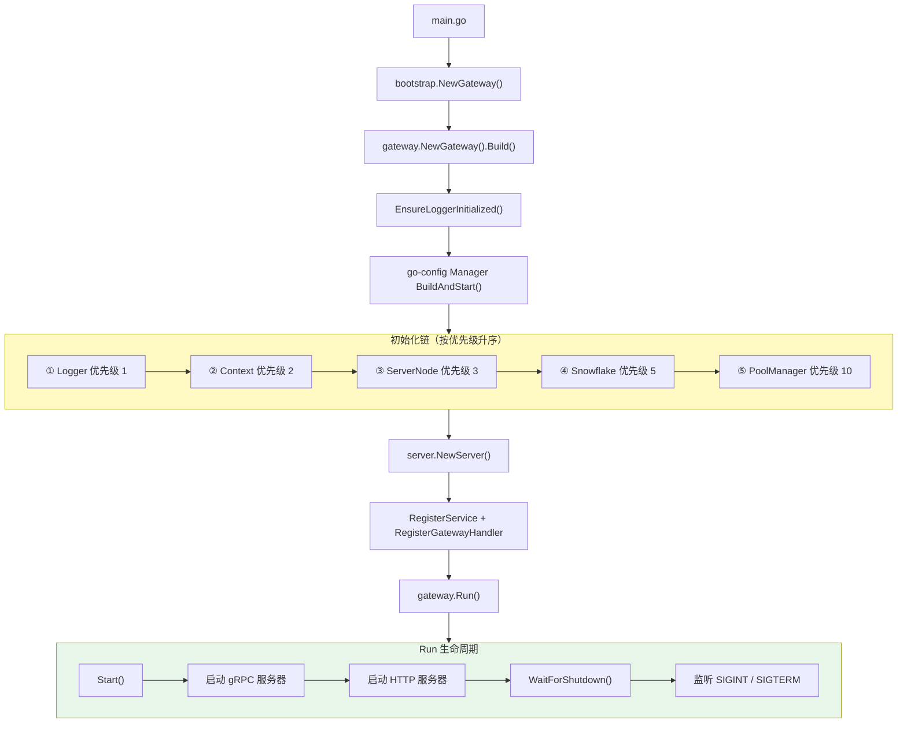

# 快速入门

本文从一个空目录开始，走完 **定义 proto → 生成 pb → 对接 Gateway → 启动验证** 四段，产出一个「同一份业务实现，HTTP 与 gRPC 双协议都能调」的服务
每一步的命令与代码都按原样跑过：最终的服务在 `:8080` 回 REST、在 `:9000` 回 gRPC，两边读写的是同一个实例只想先看网关本身起来、暂时没有服务，跳到[只要网关、还没有服务](#只要网关还没有服务)

## 成品目录

```bash
my-service/
├── go.mod
├── main.go                            # 只负责调 bootstrap
├── bootstrap/
│   └── server.go                      # 构建 Gateway + 注册服务（对接层）
├── service/
│   └── user.go                        # gRPC 接口实现（业务代码）
├── proto/user/
│   └── user_service.proto             # 接口契约（手写）
├── pb/user/                           # ← 生成物，不要手改
│   ├── user_service.pb.go
│   ├── user_service_grpc.pb.go
│   └── user_service.pb.gw.go
├── third_party/                       # proto 的 import 依赖（一次性准备）
│   ├── google/api/
│   └── protoc-gen-openapiv2/options/
├── resources/
│   ├── gateway-my-service.yaml        # 网关配置（手写）
│   └── api.swagger.yaml               # ← 生成物
└── scripts/gen-proto.sh
```

## 第 1 步：装工具链

`protoc` 按平台装（macOS `brew install protobuf`，或从 protobuf releases 下载），
四个插件用 `go install`，并确认 `$(go env GOPATH)/bin` 在 `PATH` 里 —— 否则 `protoc`
找不到插件，报的是 `protoc-gen-go: program not found or is not executable`

```bash
go install google.golang.org/protobuf/cmd/protoc-gen-go@latest
go install google.golang.org/grpc/cmd/protoc-gen-go-grpc@latest
go install github.com/grpc-ecosystem/grpc-gateway/v2/protoc-gen-grpc-gateway@latest
go install github.com/grpc-ecosystem/grpc-gateway/v2/protoc-gen-openapiv2@latest
```

| 插件 | 产物 | 作用 |
|------|------|------|
| `protoc-gen-go` | `*.pb.go` | 消息类型 |
| `protoc-gen-go-grpc` | `*_grpc.pb.go` | `XxxServiceServer` 接口、`RegisterXxxServiceServer()`、客户端桩 |
| `protoc-gen-grpc-gateway` | `*.pb.gw.go` | HTTP → gRPC 反向代理（`RegisterXxxServiceHandlerServer()` 等） |
| `protoc-gen-openapiv2` | `*.swagger.yaml` | OpenAPI 文档，喂给 Swagger UI |

建项目：

```bash
mkdir my-service && cd my-service
go mod init my-service
go get github.com/kamalyes/go-rpc-gateway
```

## 第 2 步：准备 proto 依赖

`google/protobuf/*.proto`（`timestamp.proto` 这些 well-known types）由 `protoc` 自带，
不用管但 `google/api/annotations.proto`（HTTP 路由注解）和 `protoc-gen-openapiv2`
的注解 proto **不随任何 Go 模块分发**，要自己放一份到 `third_party/`：

```bash
mkdir -p third_party
curl -sSL --create-dirs -o third_party/google/api/annotations.proto \
  https://raw.githubusercontent.com/googleapis/googleapis/master/google/api/annotations.proto
curl -sSL --create-dirs -o third_party/google/api/http.proto \
  https://raw.githubusercontent.com/googleapis/googleapis/master/google/api/http.proto
curl -sSL --create-dirs -o third_party/protoc-gen-openapiv2/options/annotations.proto \
  https://raw.githubusercontent.com/grpc-ecosystem/grpc-gateway/main/protoc-gen-openapiv2/options/annotations.proto
curl -sSL --create-dirs -o third_party/protoc-gen-openapiv2/options/openapiv2.proto \
  https://raw.githubusercontent.com/grpc-ecosystem/grpc-gateway/main/protoc-gen-openapiv2/options/openapiv2.proto
```

这四个文件提交进仓库，之后生成代码就不再需要网络

## 第 3 步：定义 proto

`proto/user/user_service.proto`：

```protobuf
syntax = "proto3";

package my.api.user;

import "google/api/annotations.proto";
import "google/protobuf/timestamp.proto";
import "protoc-gen-openapiv2/options/annotations.proto";

option go_package = "my-service/pb/user";

option (grpc.gateway.protoc_gen_openapiv2.options.openapiv2_swagger) = {
  info: {
    title: "User Service"
    description: "用户管理服务"
    version: "1.0.0"
  }
};

message CreateUserRequest {
  string username = 1;
  string email = 2;
}

message CreateUserResponse {
  string user_id = 1;
  string username = 2;
  google.protobuf.Timestamp created_at = 3;
}

message GetUserRequest {
  string user_id = 1;
}

message GetUserResponse {
  string user_id = 1;
  string username = 2;
  string email = 3;
  google.protobuf.Timestamp created_at = 4;
}

service UserService {
  rpc CreateUser(CreateUserRequest) returns (CreateUserResponse) {
    option (google.api.http) = {
      post: "/api/v1/users"
      body: "*"
    };
  }

  rpc GetUser(GetUserRequest) returns (GetUserResponse) {
    option (google.api.http) = {
      get: "/api/v1/users/{user_id}"
    };
  }
}
```

两个关键点：

- **`go_package` 必须是「模块名 + 产物目录」**，这里是 `my-service/pb/user`它决定生成的
  Go 文件落在哪、以及别人怎么 import写错了编译期才报错，且报的是找不到包
- **没有 `google.api.http` 注解的 rpc 不会有 HTTP 入口**，只能走 gRPC路径里的
  `{user_id}` 自动映射到请求消息的同名字段；`body: "*"` 表示整个 JSON body 映射到请求消息

| rpc | 注解 | REST 语义 |
|-----|------|-----------|
| `CreateUser` | `post: "/api/v1/users"` + `body: "*"` | POST 创建 |
| `GetUser` | `get: "/api/v1/users/{user_id}"` | GET 查询 |
| `UpdateUser` | `put: "/api/v1/users/{user_id}"` + `body: "*"` | PUT 更新 |
| `DeleteUser` | `delete: "/api/v1/users/{user_id}"` | DELETE 删除 |
| `ListUsers` | `get: "/api/v1/users"` | GET 列表 |

## 第 4 步：生成 pb 文件

`scripts/gen-proto.sh`：

```bash
#!/usr/bin/env bash
set -euo pipefail

# google/protobuf/*.proto（timestamp 等）由 protoc 自带，不需要额外 -I
protoc -I. -Ithird_party \
  --go_out=. --go_opt=module=my-service \
  --go-grpc_out=. --go-grpc_opt=module=my-service \
  --grpc-gateway_out=. --grpc-gateway_opt=module=my-service \
  --openapiv2_out=resources \
  --openapiv2_opt=logtostderr=true \
  --openapiv2_opt=output_format=yaml \
  --openapiv2_opt=allow_merge=true \
  --openapiv2_opt=merge_file_name=api \
  proto/user/user_service.proto
```

```bash
chmod +x scripts/gen-proto.sh
./scripts/gen-proto.sh
```

产物：

```bash
pb/user/user_service.pb.go          # 消息类型
pb/user/user_service_grpc.pb.go     # 服务接口 + 注册函数 + 客户端桩
pb/user/user_service.pb.gw.go       # HTTP 反向代理
resources/api.swagger.yaml          # OpenAPI 文档
```

三个容易踩的点：

- `--go_opt=module=my-service` 的作用是**把 `go_package` 里的模块前缀剥掉**，产物才会落在
  `pb/user/` 而不是 `my-service/pb/user/`四个插件里 `go` / `go-grpc` / `grpc-gateway`
  都支持 `module=`，**`openapiv2` 不支持**（传了会报 `no such flag -module`），所以它单独用
  `allow_merge` 把多个 proto 合并成一份 `api.swagger.yaml`
- gRPC-Gateway v2 的产物叫 **`*.pb.gw.go`**，不是 `*.gw.go`
- 产物头部记录的是本机 protoc 与插件版本，换机器重新生成会产生几行版本注释的 diff，这是正常的

## 第 5 步：实现 gRPC 服务

`*_grpc.pb.go` 生成的接口形如：

```go
// 由 protoc-gen-go-grpc 生成
type UserServiceServer interface {
    CreateUser(context.Context, *CreateUserRequest) (*CreateUserResponse, error)
    GetUser(context.Context, *GetUserRequest) (*GetUserResponse, error)
    mustEmbedUnimplementedUserServiceServer()  // 必须嵌入，保证加方法时旧实现不编译失败
}
```

`service/user.go`（示例用内存 map 存，换成你的 repository 即可）：

```go
package service

import (
    "context"
    "strconv"
    "sync"

    gwerrors "github.com/kamalyes/go-rpc-gateway/errors"
    "google.golang.org/protobuf/types/known/timestamppb"

    pb "my-service/pb/user"
)

// UserService 实现 pb.UserServiceServer
// 必须嵌入 UnimplementedUserServiceServer：接口里有 mustEmbed 方法，不嵌入编译不过
type UserService struct {
    pb.UnimplementedUserServiceServer

    mu    sync.RWMutex
    users map[string]*pb.GetUserResponse
    seq   int
}

func NewUserService() *UserService {
    return &UserService{users: make(map[string]*pb.GetUserResponse)}
}

func (s *UserService) CreateUser(ctx context.Context, req *pb.CreateUserRequest) (*pb.CreateUserResponse, error) {
    if req.GetUsername() == "" {
        // 错误码决定 HTTP 状态码与 gRPC code，详情由选项给出
        return nil, gwerrors.NewError(gwerrors.ErrCodeMissingParameter,
            gwerrors.WithDetails("username is required")).ToGRPCError()
    }

    s.mu.Lock()
    defer s.mu.Unlock()

    s.seq++
    u := &pb.GetUserResponse{
        UserId:    "u-" + strconv.Itoa(s.seq),
        Username:  req.GetUsername(),
        Email:     req.GetEmail(),
        CreatedAt: timestamppb.Now(),
    }
    s.users[u.UserId] = u

    return &pb.CreateUserResponse{
        UserId:    u.UserId,
        Username:  u.Username,
        CreatedAt: u.CreatedAt,
    }, nil
}

func (s *UserService) GetUser(ctx context.Context, req *pb.GetUserRequest) (*pb.GetUserResponse, error) {
    s.mu.RLock()
    u, ok := s.users[req.GetUserId()]
    s.mu.RUnlock()

    if !ok {
        return nil, gwerrors.NewErrorf(gwerrors.ErrCodeNotFound,
            "user %s not found", req.GetUserId()).ToGRPCError()
    }
    return u, nil
}
```

错误一律 `return nil, appErr.ToGRPCError()`：错误码既映射 gRPC `code`，也映射 HTTP 状态码，
上面两处的实际结果是 `ErrCodeMissingParameter` → `400`、`ErrCodeNotFound` → `404`**不调 `.ToGRPCError()` 直接返回 `*AppError`，对外会退化成 `Unknown` / `500`**
错误码与消息表见 [错误体系](./ERRORS.md)

> `NewError` 的第二个参数是选项而不是字符串：`NewError(code, WithDetails("..."))`，
> 需要格式化时用 `NewErrorf(code, "...", args...)`

## 第 6 步：对接 Gateway

注册分两步，**两个方法各收一个闭包**，生成代码的 `RegisterXxx` 不能直接传进去（参数个数不匹配）：

```go
type ServiceRegisterFunc       func(*grpc.Server)
type ServerHandlerRegisterFunc func(context.Context, *runtime.ServeMux) error
```

`bootstrap/server.go`：

```go
package bootstrap

import (
    "context"

    "github.com/grpc-ecosystem/grpc-gateway/v2/runtime"
    gateway "github.com/kamalyes/go-rpc-gateway"
    goconfig "github.com/kamalyes/go-rpc-gateway/config"
    "google.golang.org/grpc"

    pb "my-service/pb/user"
    "my-service/service"
)

type MyGateway struct {
    gateway *gateway.Gateway
    userSvc *service.UserService
}

func NewGateway() *MyGateway { return &MyGateway{} }

func (g *MyGateway) Run() error {
    gw, err := gateway.NewGateway().
        WithSearchPath("resources").
        WithEnvironment(goconfig.GetEnvironment()).
        WithPrefix("gateway-my-service").
        WithHotReload(nil).
        Build()
    if err != nil {
        return err
    }
    g.gateway = gw

    // 1. 初始化业务服务
    g.userSvc = service.NewUserService()

    // 2. 注册 gRPC 服务 —— 提供 gRPC 调用能力
    g.gateway.RegisterService(func(srv *grpc.Server) {
        pb.RegisterUserServiceServer(srv, g.userSvc)
    })

    // 3. 注册 HTTP Handler —— 提供 REST 能力
    //    本地实现用 HandlerServer 后缀：同进程直接调，不经过 gRPC 连接
    if err := g.gateway.RegisterGatewayHandler(func(ctx context.Context, mux *runtime.ServeMux) error {
        return pb.RegisterUserServiceHandlerServer(ctx, mux, g.userSvc)
    }); err != nil {
        return err
    }

    // 4. 启动并阻塞等信号
    return g.gateway.Run()
}
```

`main.go`：

```go
package main

import (
    "log"

    "my-service/bootstrap"
)

func main() {
    if err := bootstrap.NewGateway().Run(); err != nil {
        log.Fatalf("Gateway exited with error: %v", err)
    }
}
```

> 导入路径就是模块路径本身，**没有 `/gateway` 子包**；包名是 `gateway`，
> 与路径末段 `go-rpc-gateway` 不一致，所以显式写别名更清楚

三个 `RegisterXxxHandler` 后缀别选错，这是最常见的接错方式：

| 生成的函数 | 用在什么场景 | 对应网关方法 |
|-----------|------------|------------|
| `RegisterXxxServiceHandlerServer` | 服务在**本进程**内实现 | `RegisterGatewayHandler` |
| `RegisterXxxServiceHandler` | 代理**远程** gRPC 服务（持有 `*grpc.ClientConn`） | `RegisterProxyHandlerByServiceName` |
| `RegisterXxxServiceHandlerFromEndpoint` | 代理远程服务、手动指定地址 | `RegisterProxyHandler` |

代理模式、`AutoRegister`（基于 reflection 零注册代码）见 [服务注册](./SERVICE-REGISTRATION.md)

## 第 7 步：写配置文件

配置文件名 = `WithPrefix()` 的值 + `.yaml`，放在 `WithSearchPath()` 指向的目录下，
即 `resources/gateway-my-service.yaml`：

```yaml
name: "my-service"

grpc:
  server:
    enable: true
    host: "0.0.0.0"
    port: 9000

# 注意键名是 http，不是 http-server
# 写错不会报错，配置只是静默不生效，端口会停在默认的 8080
http:
  host: "0.0.0.0"
  port: 8080
```

要连数据库 / Redis 就再加（不配则不初始化，服务照样起）：

```yaml
database:
  enabled: true
  type: "mysql"
  dsn: "root:secret@tcp(127.0.0.1:3306)/mydb?charset=utf8mb4&parseTime=True&loc=Local"

cache:
  enabled: true
  redis:
    url: "redis://127.0.0.1:6379/0"
```

> 连接信息统一走单 DSN，每种数据库的 DSN 格式不同（MySQL 不是 URL 形式）
> 完整格式与可粘贴示例见 [连接池文档](CONNECTION-POOL.md)

## 第 8 步：启动并验证

```bash
go run .
```

应当看到启动横幅、HTTP/gRPC 两个监听端口，以及中间件与功能模块的状态表另开一个终端：

```bash
# 1) 网关自身
curl -i localhost:8080/health

# 2) REST 创建 —— 走 google.api.http 注解生成的路由
curl -X POST localhost:8080/api/v1/users \
  -H 'Content-Type: application/json' \
  -d '{"username":"alice","email":"alice@example.com"}'
# {"user_id":"u-1","username":"alice","created_at":"2026-11-08T12:52:50.775834Z"}

# 3) REST 查询 —— 路径参数 {user_id} 自动映射
curl localhost:8080/api/v1/users/u-1
# {"user_id":"u-1","username":"alice","email":"alice@example.com","created_at":"..."}

# 4) 错误码映射
curl -i localhost:8080/api/v1/users/u-404
# 404  {"code":5,"message":"Not found: user u-404 not found","details":[]}
curl -i -X POST localhost:8080/api/v1/users -H 'Content-Type: application/json' -d '{}'
# 400  {"code":3,"message":"Missing parameter: username is required","details":[]}
```

`/health` 以及所有响应头里都会带 `X-Trace-Id`、`X-Request-Id`、`X-Server-Node` ——
它们由恒定开启的请求上下文中间件注入，是全链路追踪的起点（见
[请求上下文](./REQUEST-CONTEXT.md)）

同一份实现在 `:9000` 上就是 gRPC 服务，用生成的客户端桩直接调：

```go
conn, err := grpc.NewClient("localhost:9000", grpc.WithTransportCredentials(insecure.NewCredentials()))
if err != nil {
    log.Fatal(err)
}
defer conn.Close()

cli := pb.NewUserServiceClient(conn)
created, err := cli.CreateUser(ctx, &pb.CreateUserRequest{Username: "bob", Email: "bob@example.com"})
// created.GetUserId() == "u-2"，紧接着 curl localhost:8080/api/v1/users/u-2 也能读到
// 错误同样是 gRPC 原生错误：rpc error: code = NotFound desc = Not found: user nope not found
```

`Ctrl-C` 或 `kill -TERM` 触发优雅关闭，日志里会打出 `Gateway正在优雅关闭` → `Gateway已安全关闭`

## 第 9 步：Swagger UI（可选）

第 4 步已经生成了 `resources/api.swagger.yaml`，配置里指过去即可：

```yaml
swagger:
  enabled: true
  ui-path: "/swagger"          # 不要带结尾斜杠，否则注册出来的路由是 /swagger//index.html
  spec-path: "resources/api.swagger.yaml"
```

- 键名是 **`spec-path`**（单服务模式），不是 `paths`写错不会报错，只会在日志里留一条
  `加载Swagger文件失败: ./docs/swagger.yaml`（默认值），UI 能打开但是空的
- UI 在 `http://localhost:8080/swagger/`，它读的 spec 是 `/swagger/swagger.json`
- 多服务聚合模式用 `swagger.aggregate`，见 [Server 内部机制](./SERVER.md)

### 给文档加锁

上面这样配完，`/swagger` 下的全部内容（UI 页面、规范 JSON、服务与文档列表、调试端点）
任何人都能访问。接口文档会把全部路由、参数结构和错误码一次性摊开，
是整个服务对外暴露面最大的一个端点，公网可达时建议加上 `auth`：

```yaml
swagger:
  enabled: true
  ui-path: "/swagger"
  spec-path: "resources/api.swagger.yaml"
  auth:
    type: "basic"              # basic / bearer / custom，大小写都行
    username: "admin"
    password: "s3cret"
```

```bash
curl -s -o /dev/null -w '%{http_code}\n' localhost:8080/swagger/
# 401

curl -s -o /dev/null -w '%{http_code}\n' -u admin:s3cret localhost:8080/swagger/
# 200
```

浏览器打开 `http://localhost:8080/swagger/` 会弹原生登录框，
进去之后右上角有个 🔒 **已认证 · Basic** 的标识，带「退出」入口
没配 `auth` 时那里显示 🔓 **公开访问**，提醒文档是敞开的

另外两种方式用于机器调用方：

```yaml
  auth:
    type: "bearer"
    token: "your-token"        # Authorization: Bearer your-token
```

```yaml
  auth:
    type: "custom"
    header-name: "X-Docs-Key"  # 任意请求头
    header-value: "your-key"
```

- `bearer` 与 `custom` 接不上浏览器原生弹窗，所以也支持 `?token=xxx`：
  校验通过后会换发一个 `HttpOnly` 会话 Cookie 并重定向掉 URL 里的 `token`，
  后续页面内 Swagger UI 取 `swagger.json` 的请求靠这个 Cookie 过鉴权
- **`auth` 块写了一半会锁死整个文档**，这是故意的：类型拼错（`bascis`）、
  密码漏配、或者只写 `enabled: true` 不写 `type`，都会拒绝全部请求并在日志里留一条
  `Swagger 认证配置无效，文档将拒绝所有访问`宁可访问不了，也不能因为一个错别字让文档裸奔
- 反过来，`enabled: false` 配上完整的 `type`/凭据**仍然加锁**要彻底关掉就把 `auth`
  整块删掉，或者写 `type: none`
- 完整说明见 [Swagger 中间件文档](../middleware/swagger/README.md)

## `Build()` / `BuildAndStart()` / `Run()` 怎么配

这三个方法很容易配错，而配错的表现是「进程启动后立刻退出」，不是报错崩溃，
所以值得单独说清

| 组合 | 行为 | 对不对 |
|------|------|--------|
| `Build()` + `Run()` | `Run()` 负责 `Start()` 与 `WaitForShutdown()` | ✅ 推荐 |
| `BuildAndStart()` + `WaitForShutdown()` | 构建时就启动，之后只阻塞等信号 | ✅ 需要在启动后再做事时用 |
| `BuildAndStart()` + `Run()` | **启动两次** | ❌ 见下 |
| `Build()` 之后什么都不调 | 从未启动，`main` 直接返回 | ❌ |

`BuildAndStart()` 内部已经调过 `Start()`再调 `Run()` 时 `Run()` 会又调一次
`Start()`，而 `Start()` 对已在运行的 Server 返回 `"server is already running"`；
`Run()` 拿到这个错误就**直接返回，根本不会进 `WaitForShutdown()`**
如果调用方还忽略了 `Run()` 的返回值，`main()` 随即结束、进程退出 ——
两个端口刚起来就被关掉，一个请求都不会被服务

需要「启动后再做点事，然后阻塞」时这样写：

```go
gw, err := gateway.NewGateway().
    WithSearchPath("resources").
    WithPrefix("gateway-my-service").
    BuildAndStart()
if err != nil {
    log.Fatalf("Gateway startup failed: %v", err)
}

// 此处网关已在服务

if err := gw.WaitForShutdown(); err != nil {
    log.Fatalf("Gateway exited with error: %v", err)
}
```

## 只要网关、还没有服务

proto 还没定下来、只想先确认网关本身能起来，`main.go` 就这些：

```go
package main

import (
    "log"

    gateway "github.com/kamalyes/go-rpc-gateway"
    goconfig "github.com/kamalyes/go-rpc-gateway/config"
)

func main() {
    gw, err := gateway.NewGateway().
        WithSearchPath("resources").
        WithEnvironment(goconfig.GetEnvironment()).
        WithPrefix("gateway-my-service").
        WithHotReload(nil).
        Build()
    if err != nil {
        log.Fatalf("Gateway build failed: %v", err)
    }

    // Run = Start + WaitForShutdown，会阻塞直到收到 SIGINT / SIGTERM
    if err := gw.Run(); err != nil {
        log.Fatalf("Gateway exited with error: %v", err)
    }
}
```

配上第 7 步那份 yaml，`go run .` 之后 `curl localhost:8080/health` 就有响应；
业务路由此时一条都没有，等第 3～6 步补齐

## 继续拆分 bootstrap

服务多了之后，把初始化、注册、迁移按文件拆开，`Run()` 只留编排：

```go
func (g *MyGateway) Run() error {
    gw, err := gateway.NewGateway().
        WithSearchPath("resources").
        WithEnvironment(goconfig.GetEnvironment()).
        WithPrefix("gateway-my-service").
        WithHotReload(nil).
        Build()
    if err != nil {
        return err
    }
    g.gateway = gw

    g.initServices()           // bootstrap/services.go
    g.initDatabase()           // bootstrap/database.go
    g.registerGRPCServices()   // bootstrap/register.go

    // 自定义 gRPC-Gateway 中间件要在 RebuildHTTPGateway 之前挂上
    g.gateway.AddGrpcGatewayMiddlewareProvider(g.getMiddleware)
    if err := g.gateway.RebuildHTTPGateway(); err != nil {
        return err
    }

    // HTTP Handler 必须在 RebuildHTTPGateway 之后注册，否则注册到的是被换掉的那个 mux
    g.registerHTTPHandlers()

    return g.gateway.Run()
}
```

> 不需要自定义中间件时，`AddGrpcGatewayMiddlewareProvider` + `RebuildHTTPGateway`
> 这两步整个跳过 —— 第 6 步那版就是跳过的写法

### bootstrap/services.go — 初始化业务服务

```go
package bootstrap

import (
    gwglobal "github.com/kamalyes/go-rpc-gateway/global"

    "my-service/repository"
    "my-service/service"
)

func (g *MyGateway) initServices() {
    db := gwglobal.GetDB()       // 配置里没开 database 时返回 nil
    redis := gwglobal.GetRedis() // 配置里没开 cache 时返回 nil

    userRepo := repository.NewUserRepository(db)
    g.userSvc = service.NewUserService(userRepo, redis)
}
```

> 源码参考：[global.go:GetDB()](../global/global.go)、[global.go:GetRedis()](../global/global.go)

### bootstrap/database.go — 数据库迁移（可选）

```go
package bootstrap

import (
    gwglobal "github.com/kamalyes/go-rpc-gateway/global"

    "my-service/models"
)

func (g *MyGateway) initDatabase() {
    db := gwglobal.GetDB()
    if db == nil {
        return
    }
    if err := db.AutoMigrate(&models.User{}, &models.Order{}); err != nil {
        gwglobal.LOGGER.Fatal("AutoMigrate failed: %v", err)
    }
}
```

## 启动流程总结



> 源码参考：[initializer.go:GetDefaultInitializerChain()](../global/initializer.go)

## 下一步

- [服务注册](./SERVICE-REGISTRATION.md) — 代理远程服务、`AutoRegister`、注册顺序的完整规则
- [Gateway 构建器](./GATEWAY-BUILDER.md) — 了解所有构建选项与配置发现
- [错误体系](./ERRORS.md) — 错误码表、三态映射、业务码注册
- [中间件系统](./MIDDLEWARE.md) — CORS、限流、熔断、签名等 15+ 中间件
