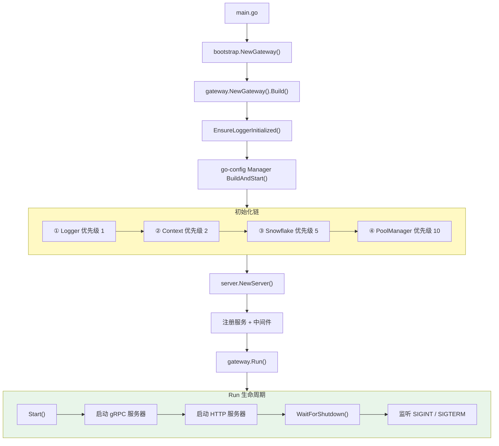

# 快速入门

## 最小示例

```go
package main

import (
    "log"

    gateway "github.com/kamalyes/go-rpc-gateway"
    goconfig "github.com/kamalyes/go-rpc-gateway/config"
)

func main() {
    gw, err := gateway.NewGateway().
        WithSearchPath("resources").
        WithEnvironment(goconfig.GetEnvironment()).
        WithPrefix("gateway-my-service").
        WithHotReload(nil).
        Build()
    if err != nil {
        log.Fatalf("Gateway build failed: %v", err)
    }

    // 注册你的服务（第 2 步会讲）
    // gw.RegisterService(pb.RegisterUserServiceServer, userSvc)
    // gw.RegisterGatewayHandler(pb.RegisterUserServiceHandlerServer)

    // Run = Start + WaitForShutdown，会阻塞直到收到 SIGINT / SIGTERM
    if err := gw.Run(); err != nil {
        log.Fatalf("Gateway exited with error: %v", err)
    }
}
```

> 导入路径就是模块路径本身，**没有 `/gateway` 子包**；包名是 `gateway`，
> 与路径末段 `go-rpc-gateway` 不一致，所以显式写别名更清楚。

### `Build()` / `BuildAndStart()` / `Run()` 怎么配

这三个方法很容易配错，而配错的表现是「进程启动后立刻退出」，不是报错崩溃，
所以值得单独说清。

| 组合 | 行为 | 对不对 |
|------|------|--------|
| `Build()` + `Run()` | `Run()` 负责 `Start()` 与 `WaitForShutdown()` | ✅ 推荐 |
| `BuildAndStart()` + `WaitForShutdown()` | 构建时就启动，之后只阻塞等信号 | ✅ 需要在启动后再做事时用 |
| `BuildAndStart()` + `Run()` | **启动两次** | ❌ 见下 |
| `Build()` 之后什么都不调 | 从未启动，`main` 直接返回 | ❌ |

`BuildAndStart()` 内部已经调过 `Start()`。再调 `Run()` 时 `Run()` 会又调一次
`Start()`，而 `Start()` 对已在运行的 Server 返回 `"server is already running"`；
`Run()` 拿到这个错误就**直接返回，根本不会进 `WaitForShutdown()`**。
如果调用方还忽略了 `Run()` 的返回值，`main()` 随即结束、进程退出 ——
两个端口刚起来就被关掉，一个请求都不会被服务。

需要「启动后再做点事，然后阻塞」时这样写：

```go
gw, err := gateway.NewGateway().
    WithSearchPath("resources").
    WithPrefix("gateway-my-service").
    BuildAndStart()
if err != nil {
    log.Fatalf("Gateway startup failed: %v", err)
}

// 此处网关已在服务

if err := gw.WaitForShutdown(); err != nil {
    log.Fatalf("Gateway exited with error: %v", err)
}
```

### 验证跑通了

```bash
go run .
```

应当看到启动横幅与监听端口。另开一个终端：

```bash
curl -i localhost:8080/health
```

有响应就说明第 1 步完成。响应头里还会带上 `X-Trace-Id` 与 `X-Request-Id` ——
它们由恒定开启的请求上下文中间件注入，是全链路追踪的起点。

## 配置文件

在 `resources/` 目录下创建 `gateway-my-service.yaml`：

```yaml
name: "my-service"

grpc:
  server:
    enable: true
    host: "0.0.0.0"
    port: 9000

# 注意键名是 http，不是 http-server
# 写错不会报错，配置只是静默不生效，端口会停在默认的 8080
http:
  host: "0.0.0.0"
  port: 8080

database:
  enabled: true
  type: "mysql"
  dsn: "root:secret@tcp(127.0.0.1:3306)/mydb?charset=utf8mb4&parseTime=True&loc=Local"

cache:
  enabled: true
  redis:
    url: "redis://127.0.0.1:6379/0"
```

> 连接信息统一走单 DSN，每种数据库的 DSN 格式不同（MySQL 不是 URL 形式）。
> 完整格式与可粘贴示例见 [连接池文档](CONNECTION-POOL.md)

## Bootstrap 模式拆分

推荐将启动逻辑拆分到 `bootstrap/` 包中，保持 `main.go` 极简：

### main.go

```go
package main

import (
    "log"
    "os"

    "my-service/bootstrap"
)

func main() {
    gw := bootstrap.NewGateway()
    if err := gw.Run(); err != nil {
        log.Fatalf("Gateway startup failed: %v", err)
        os.Exit(1)
    }
}
```

### bootstrap/server.go — 构建 Gateway

```go
package bootstrap

import (
    goconfig "github.com/kamalyes/go-rpc-gateway/config"
    "github.com/kamalyes/go-rpc-gateway"
    gwglobal "github.com/kamalyes/go-rpc-gateway/global"
)

type MyGateway struct {
    gateway *gateway.Gateway
    // ... 你的服务字段
}

func NewGateway() *MyGateway {
    return &MyGateway{}
}

func (g *MyGateway) Run() error {
    // 1. 构建 Gateway
    gw, err := gateway.NewGateway().
        WithSearchPath("resources").
        WithEnvironment(goconfig.GetEnvironment()).
        WithPrefix("gateway-my-service").
        WithHotReload(nil).
        Build()
    if err != nil {
        return err
    }
    g.gateway = gw

    // 2. 初始化服务
    g.initServices()

    // 3. 注册 gRPC 服务
    g.registerGRPCServices()

    // 4. 添加中间件并重建 HTTP Gateway
    g.gateway.AddGrpcGatewayMiddlewareProvider(g.getMiddleware)
    g.gateway.RebuildHTTPGateway()

    // 5. 注册 HTTP Handlers
    g.registerHTTPHandlers()

    // 6. 启动并等待信号
    return g.gateway.Run()
}
```

> 源码参考：[gateway.go:Build()](../gateway.go)、[gateway.go:Run()](../gateway.go)

### bootstrap/services.go — 初始化业务服务

```go
package bootstrap

import (
    gwglobal "github.com/kamalyes/go-rpc-gateway/global"
    "my-service/repository"
    "my-service/service"
)

func (g *MyGateway) initServices() {
    db := gwglobal.GetDB()
    redis := gwglobal.GetRedis()

    // 初始化 Repository
    userRepo := repository.NewUserRepository(db)

    // 初始化 Service
    g.userSvc = service.NewUserService(userRepo, redis)
}
```

> 源码参考：[global.go:GetDB()](../global/global.go)、[global.go:GetRedis()](../global/global.go)

### bootstrap/database.go — 数据库迁移（可选）

```go
package bootstrap

import (
    gwglobal "github.com/kamalyes/go-rpc-gateway/global"
    "my-service/models"
)

func (g *MyGateway) initDatabase() {
    db := gwglobal.GetDB()
    if db != nil {
        db.AutoMigrate(
            &models.User{},
            &models.Order{},
        )
    }
}
```

## 启动流程总结



> 源码参考：[initializer.go:GetDefaultInitializerChain()](../global/initializer.go)

## 下一步

- [Gateway 构建器](./GATEWAY-BUILDER.md) — 了解所有构建选项
- [服务注册](./SERVICE-REGISTRATION.md) — 了解 gRPC 和 HTTP 注册模式
