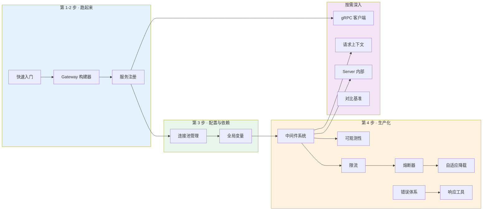

# go-rpc-gateway 文档

基于 grpc-gateway 的微服务网关框架：一套 proto 同时提供 gRPC 与 HTTP/JSON，
配置驱动，自带请求上下文透传、可观测性、限流熔断降载与连接池。

---

## 我刚拿到这个框架，接下来做什么？

按顺序走这四步。每一步都能独立跑起来、看到结果，不要跳。

### 第 1 步 · 跑起来（约 5 分钟）

写一个 `main.go` 和一份 YAML，启动一个空网关，确认 HTTP 与 gRPC 两个端口都在听。

→ **[快速入门 · 最小示例](./QUICKSTART.md#最小示例)**

这一步结束时你应该看到启动横幅，并且 `curl localhost:8080/health` 有响应。
没跑通先别往下走 —— 后面每一步都建立在这个基础上。

### 第 2 步 · 接上你的第一个 gRPC 服务（约 20 分钟）

把 proto 生成的 `RegisterXXXServiceServer` 和 `RegisterXXXServiceHandler` 挂到网关上，
让同一个方法既能用 gRPC 调，也能用 HTTP POST 调。

→ **[服务注册](./SERVICE-REGISTRATION.md)** — 四种注册模式分别什么时候用
→ **[Gateway 构建器](./GATEWAY-BUILDER.md)** — `Build()` 与 `BuildAndStart()` 的区别

这一步的关键选择：服务和网关**同进程**（本地 handler），还是**跨进程**（代理到远端）。
两者注册方式不同，[服务注册](./SERVICE-REGISTRATION.md) 开头的决策表直接告诉你选哪个。

### 第 3 步 · 把配置接管起来（约 30 分钟）

配置是这个框架的主要交互面 —— 中间件开关、连接池、限流阈值全在 YAML 里。
搞清楚配置文件是怎么被发现的、环境怎么切、哪些改动能热重载。

→ **[快速入门 · 配置文件](./QUICKSTART.md#配置文件)** — 最小可用配置
→ **[连接池管理](./CONNECTION-POOL.md)** — DB/Redis/ClickHouse/Kafka 等的 DSN 格式
→ **[全局变量与初始化器](./GLOBAL.md)** — 在业务代码里怎么拿到 DB、Redis、Logger

这一步最容易踩的坑：各数据库的 DSN 格式不统一（MySQL 不是 URL 形式），
[连接池文档](./CONNECTION-POOL.md) 里每种都有可直接粘贴的示例。

### 第 4 步 · 上生产前（约 1 小时）

默认配置是**开发**导向的。上生产要显式打开并调一遍这些：

| 要做的事 | 去哪看 |
|---------|--------|
| 打开访问日志，确认敏感字段被脱敏 | [中间件系统 · 日志](./MIDDLEWARE.md) |
| 打开 Prometheus 指标与健康检查 | [中间件系统 · 可观测性](./MIDDLEWARE.md) |
| 设限流阈值（默认 100 QPS，几乎一定要改） | [中间件系统 · 限流](./MIDDLEWARE.md) |
| 配熔断与降载，确认链序 | [熔断器](./BREAKER.md)、[自适应降载](./SHEDDER.md) |
| 统一错误码与 HTTP 状态码映射 | [错误体系](./ERRORS.md) |
| 确认优雅关闭与热重载行为 | [Server 内部机制](./SERVER.md) |
| 估算框架开销 | [对比基准](../benchmark/README.md) |
| 评估「开启访问日志/审计钩子」的代价 | [对比基准 · 分配次数主表](../benchmark/README.md) |

---

## 我想做一件具体的事

| 我要… | 去哪看 |
|-------|--------|
| 让一个 proto 方法同时提供 gRPC 和 HTTP | [服务注册](./SERVICE-REGISTRATION.md) |
| 在业务代码里取 trace_id / user_id / 租户 | [请求上下文](./REQUEST-CONTEXT.md) |
| 让 trace_id 一路透传到下游服务 | [请求上下文](./REQUEST-CONTEXT.md) |
| 调另一个 gRPC 服务（带健康检查/负载均衡） | [gRPC 客户端](./GRPC-CLIENT.md) |
| 加一个自定义中间件 | [中间件系统](./MIDDLEWARE.md) |
| 按用户/IP/路由做不同的限流 | [中间件系统 · 动态限流](./MIDDLEWARE.md) |
| 保护下游不被打挂 | [熔断器](./BREAKER.md) |
| 过载时主动丢请求而不是全体变慢 | [自适应降载](./SHEDDER.md) |
| 返回统一格式的 JSON 错误 | [错误体系](./ERRORS.md)、[HTTP 响应工具](./RESPONSE.md) |
| 取数据库 / Redis / Kafka 连接 | [连接池管理](./CONNECTION-POOL.md) |
| 开 Swagger UI、聚合多服务文档 | [Server 内部机制 · Swagger](./SERVER.md) |
| 支持 WebSocket | [Server 内部机制 · WebSocket](./SERVER.md#websocket) |
| 不重启改配置 | [Gateway 构建器 · 热重载](./GATEWAY-BUILDER.md) |
| 判断该不该用这个框架 | [与 go-zero 对比](./COMPARISON.md)、[对比基准](../benchmark/README.md) |

---

## 按组件查参考

| 文档 | 内容 |
|------|------|
| [Gateway 构建器](./GATEWAY-BUILDER.md) | `GatewayBuilder` 全部链式选项、配置发现、热重载 |
| [服务注册](./SERVICE-REGISTRATION.md) | gRPC 服务与 HTTP Handler 的四种注册模式 |
| [Server 内部机制](./SERVER.md) | 双服务器、生命周期、热重载、Swagger、多端口监听 |
| [请求上下文](./REQUEST-CONTEXT.md) | HTTP → gRPC → Service 全链路 33 个字段的传递 |
| [中间件系统](./MIDDLEWARE.md) | 全部中间件、链序理由、动态签名/限流提供器 |
| [熔断器](./BREAKER.md) | 状态机、管理器、HTTP/gRPC 两侧接入 |
| [自适应降载](./SHEDDER.md) | 三信号判定、承载上限估算、CPU 采样、链序与冷却 |
| [连接池管理](./CONNECTION-POOL.md) | `Manager` 统一管理 DB/Redis/ClickHouse/Kafka/NATS/MQTT/OTS/SMTP |
| [gRPC 客户端](./GRPC-CLIENT.md) | 泛型 `InitClient`、健康检查、负载均衡、压缩、发版感知 |
| [全局变量与初始化器](./GLOBAL.md) | 全局状态、`InitializerChain`、Snowflake ID |
| [错误体系](./ERRORS.md) | `ErrorCode`、`AppError`、三态映射、gRPC 转换、i18n |
| [HTTP 响应工具](./RESPONSE.md) | 统一 JSON 响应写入 |
| [与 go-zero 对比](./COMPARISON.md) | 选型参考：设计分歧、功能矩阵、迁移前要实测什么 |
| [对比基准](../benchmark/README.md) | 与原生 grpc-gateway 的实测开销（独立模块） |

---

## 学习路径



---

## 项目结构

只列到**包**一级，不列单个文件 —— 文件级清单是上一版这份文档里 100 多条路径
失效的直接原因：粒度越细漂移越快，而读者真正需要的是「哪个包管什么」。

```
go-rpc-gateway/
├── gateway.go                 # 入口：Gateway 与链式构建器 GatewayBuilder
│
├── server/                    # Server 核心：gRPC/HTTP 双服务器、生命周期、热重载、路由注册
├── middleware/                # 中间件门面：Manager 组装链，index.go 转发各子包 API
│   ├── core/                  #   恒定开启层：Recovery、RequestContext、ResponseWriter、路径规范化
│   ├── observability/         #   访问日志、Prometheus 指标、OTel 追踪、健康检查、pprof
│   ├── resilience/            #   限流、熔断、自适应降载
│   ├── security/              #   CORS/CSP、签名验证、Nonce 防重放、白名单规则引擎
│   ├── i18n/                  #   国际化与 struct tag 校验
│   └── swagger/               #   Swagger UI、多服务文档聚合、注解富化
│
├── config/                    # 配置体系：环境发现、热重载
│   ├── core/                  #   网关核心配置（Gateway/HTTPServer/GRPC/RequestContext/JSON）
│   ├── middleware/            #   各中间件的配置结构与默认值
│   └── cache|database|kafka|ots|queue|smtp|swagger|tsdb/
│
├── cpool/                     # 连接池：Manager 是所有连接的唯一管理者
│   ├── grpc/                  #   gRPC 客户端：健康检查、负载均衡、熔断、自动注册、发版感知
│   ├── database/              #   MySQL / PostgreSQL / SQLite（含 GORM 自定义类型）
│   ├── redis|clickhouse/      #   Redis、ClickHouse
│   ├── kafka|ots/             #   Kafka、阿里云 Tablestore（按构建标签，未启用时零依赖）
│   └── nats|mqtt|smtp/        #   NATS/JetStream、MQTT、SMTP
│
├── global/                    # 全局状态、InitializerChain、Snowflake ID 生成
├── errors/                    # 错误体系：ErrorCode、AppError、三态映射、gRPC 转换
├── response/                  # 统一 HTTP JSON 响应写入
├── constants/                 # 跨包共享常量（metadata 键、header 名、日志消息）
├── proto/                     # 公共 proto（Result、StatusCode）
│
├── benchmark/                 # 与原生 grpc-gateway 的对比基准（独立 Go 模块）
└── docs/                      # 本文档目录
```

---

## 文档约定

- **源码链接不带行号。** 行号随每次改动漂移，而漂移了的行号比没有行号更糟 ——
  它会把读者带到一段无关的代码上。链接指向文件，按符号名在文件里搜即可。
- **代码示例里的导入路径可直接粘贴。** 根包就是模块路径本身
  （`github.com/kamalyes/go-rpc-gateway`，包名 `gateway`），没有 `/gateway` 子包。
- **性能数字都有出处。** 凡出现 ns/op 一类的数字，都能在
  [benchmark](../benchmark/) 里重跑复现；没有基准支撑的性能说法不写进文档。
