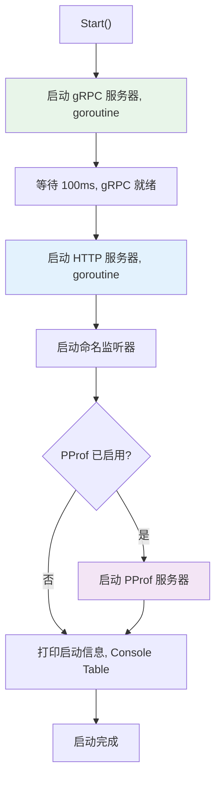
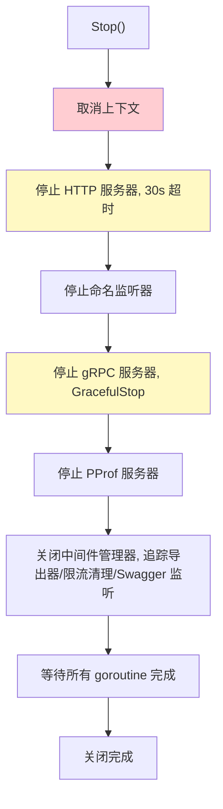
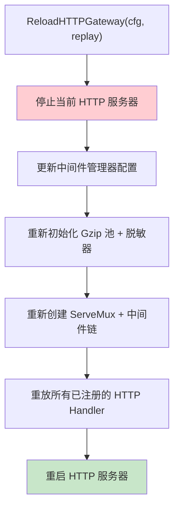
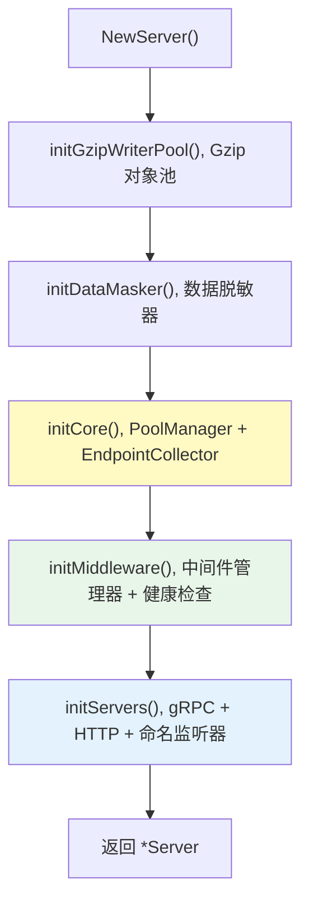

# Server 内部机制

## 概述

`server.Server` 是 Gateway 的底层服务器实现，管理 gRPC 和 HTTP 双服务器的生命周期、中间件挂载、热重载等。

> 源码目录：[server/](../server/)

## Server 结构

> 源码：[server/server.go:Server](../server/server.go)

```go
type Server struct {
    config *gwconfig.Gateway

    // 服务器组件
    grpcServer  *grpc.Server
    httpServer  *http.Server
    gwMux       *runtime.ServeMux
    pprofServer *middleware.PProfServer
    httpMux     *http.ServeMux

    // 命名监听器（多端口支持，如 Ops/Tenant 分离）
    namedListeners map[string]*namedListener

    // 中间件管理器
    middlewareManager *middleware.Manager

    // grpc-gateway 中间件（runtime.Middleware）
    grpcGatewayMiddlewares         []runtime.Middleware
    grpcGatewayMiddlewareProviders []func() []runtime.Middleware

    // 健康检查管理器
    healthManager *middleware.HealthManager

    // Banner管理器
    bannerManager *BannerManager

    // 连接池管理器
    poolManager cpool.PoolManager

    // 端点信息收集器
    endpointCollector *EndpointCollector

    // Gzip writer 对象池（用于 HTTP 压缩优化）
    gzipWriterPool *sync.Pool

    // Gzip 跳过规则（启动时预处理，避免每请求读配置切片）
    // 前缀必须逐个 HasPrefix，用切片；扩展名在「每项都是单个点开头」时
    // 另建一张 map 做单次查找，否则退回逐个 HasSuffix 以保住 .min.js 的语义
    gzipSkipPrefixes  []string
    gzipSkipSuffixes  []string
    gzipSkipExtMap    map[string]struct{}
    httpRoutePatterns map[string]struct{}

    // 数据脱敏器（用于日志敏感数据脱敏）
    dataMasker *desensitize.DataMasker

    // 状态管理
    ctx    context.Context
    cancel context.CancelFunc
    wg     sync.WaitGroup

    // 运行状态
    running bool
    mu      sync.RWMutex
}
```

### 访问器方法

| 方法 | 返回类型 |
|------|---------|
| `GetGatewayMux()` | `*runtime.ServeMux` |
| `GetConfig()` | `*gwconfig.Gateway` |
| `GetMiddlewareManager()` | `*middleware.Manager` |
| `GetBannerManager()` | `*BannerManager` |
| `GetPoolManager()` | `cpool.PoolManager` |
| `GetEndpointCollector()` | `*EndpointCollector` |
| `GetDataMasker()` | `*desensitize.DataMasker` |
| `GetGRPCServer()` | `*grpc.Server` |
| `GetEndpoint()` | `string` |
| `GetContext()` | `context.Context` |
| `GetDialOptions()` | `[]grpc.DialOption` |

> 源码：[server/server.go](../server/server.go)

### 注册方法

| 方法 | 说明 | 源码 |
|------|------|------|
| `RegisterGRPCService(fn)` | 注册 gRPC 服务 | [server.go](../server/server.go) |
| `AddGrpcGatewayMiddleware(mw)` | 添加 gRPC-Gateway 中间件 | [server.go](../server/server.go) |
| `AddGrpcGatewayMiddlewareProvider(fn)` | 添加延迟中间件提供器 | [server.go](../server/server.go) |
| `RegisterHTTPRoute(pattern, handler)` | 注册 HTTP 路由 | [http.go](../server/http.go) |
| `RegisterHTTPHandlerFunc(pattern, fn)` | 注册 HTTP 处理函数 | [http.go](../server/http.go) |

## 核心组件

### 核心初始化 — core.go

> 源码：[server/core.go:initCore()](../server/core.go)

```go
func (s *Server) initCore() error {
    if global.POOL_MANAGER == nil {
        return errors.NewError(errors.ErrCodeInternalServerError,
            errors.WithDetails("global POOL_MANAGER is not initialized, ensure InitializerChain has run"))
    }
    s.poolManager = global.POOL_MANAGER
    s.endpointCollector = NewEndpointCollector()
    return nil
}
```

### gRPC 服务器 — grpc.go

> 源码：[server/grpc.go:initGRPCServer()](../server/grpc.go)

初始化流程：

1. 检查 `grpc.server.enable` 配置 → [grpc.go](../server/grpc.go)
2. 监控消息大小配置（1MB–100MB 推荐范围） → [grpc.go](../server/grpc.go)
3. Keepalive 参数配置 → [grpc.go](../server/grpc.go)
4. 连接超时与 Enforcement Policy → [grpc.go](../server/grpc.go)
5. 挂载 Unary 拦截器链 → [grpc.go](../server/grpc.go)
6. 挂载 Stream 拦截器链 → [grpc.go](../server/grpc.go)
7. 启用 gRPC 反射（reflection） → [grpc.go](../server/grpc.go)

Unary 拦截器链（按执行顺序）：

| 顺序 | 拦截器 | 可选 | 说明 |
|------|--------|------|------|
| 1 | `UnaryServerRequestContextInterceptor` | 否 | 注入 trace_id/request_id |
| 2 | `UnaryServerLoggingInterceptor` | 否 | 日志记录 |
| 3 | `GRPCUnaryI18nInterceptor` | 是 | i18n 国际化上下文 |
| 4 | `GRPCMetricsInterceptor` | 是 | Prometheus 指标 |
| 5 | `GRPCTracingInterceptor` | 是 | OpenTelemetry 追踪 |
| 6 | `GRPCRateLimitUnaryInterceptor` | 是 | 限流控制 |
| 7 | `GRPCStructTagValidatorInterceptor` | 否 | struct tag 参数校验 |
| 8 | `UnaryServerCompressionInterceptor` | 是 | 响应压缩 |

启动 gRPC 服务器：[grpc.go:startGRPCServer()](../server/grpc.go)

停止 gRPC 服务器：[grpc.go:stopGRPCServer()](../server/grpc.go)

### HTTP 服务器 — http.go

> 源码：[server/http.go](../server/http.go)

#### JSON 序列化配置

> 源码：[http.go:buildServeMuxOptions()](../server/http.go)

```go
func (s *Server) buildServeMuxOptions() []runtime.ServeMuxOption {
    useProtoNames := s.config.JSON.UseProtoNames
    emitUnpopulated := s.config.JSON.EmitUnpopulated
    discardUnknown := s.config.JSON.DiscardUnknown

    opts := []runtime.ServeMuxOption{
        runtime.WithMarshalerOption(runtime.MIMEWildcard, &runtime.JSONPb{
            MarshalOptions: protojson.MarshalOptions{
                UseProtoNames:   useProtoNames,
                EmitUnpopulated: emitUnpopulated,
            },
            UnmarshalOptions: protojson.UnmarshalOptions{
                DiscardUnknown: discardUnknown,
            },
        }),
        runtime.WithIncomingHeaderMatcher(func(key string) (string, bool) {
            // HTTP/2 规范禁止的头，转发会导致 gRPC 服务端发送 RST_STREAM
            switch strings.ToLower(key) {
            case "connection", "keep-alive", "proxy-connection",
                "transfer-encoding", "upgrade", "te":
                return key, false
            case "authorization":
                // grpc-gateway 的 AnnotateContext 已无条件转发，匹配会导致重复
                return key, false
            }
            return key, true
        }),
    }

    // 启用 Protobuf 响应支持
    if s.config.GRPC != nil && s.config.GRPC.Server != nil && s.config.GRPC.Server.EnableProtobufResp {
        opts = append(opts, runtime.WithMarshalerOption("application/x-protobuf", &protobufMarshaler{}))
        opts = append(opts, runtime.WithMarshalerOption("application/protobuf", &protobufMarshaler{}))
    }

    return opts
}
```

#### Gzip 压缩

> 源码：[http.go:initGzipWriterPool()](../server/http.go)、[http.go:gzipMiddleware()](../server/http.go)

- 使用 `sync.Pool` 复用 gzip.Writer
- 预处理跳过路径和扩展名为 map（O(1) 查找）
- 在日志中间件之后执行，避免记录压缩后的乱码

#### 数据脱敏

> 源码：[http.go:initDataMasker()](../server/http.go)

```go
func (s *Server) initDataMasker() {
    config := &desensitize.MaskerConfig{
        SensitiveKeys: s.config.Middleware.Logging.SensitiveKeys,
        SensitiveMask: s.config.Middleware.Logging.SensitiveMask,
        MaxBodySize:   s.config.Middleware.Logging.MaxBodySize,
    }
    s.dataMasker = desensitize.NewMasker(config)
    global.DATAMASKER = s.dataMasker
}
```

#### HTTP Gateway 初始化

> 源码：[http.go:initHTTPGateway()](../server/http.go)

初始化流程：

1. 创建 gRPC-Gateway ServeMux（含 JSON 序列化 + Header 传递） → [http.go](../server/http.go)
2. 收集 gRPC-Gateway 中间件（静态 + 动态提供器），去重 → [http.go](../server/http.go)
3. 自动注入 struct tag 校验中间件 → [http.go](../server/http.go)
4. 创建 HTTP Mux，注册默认路由 `/` → gwMux → [http.go](../server/http.go)
5. 注册健康检查端点 → [http.go](../server/http.go)
6. 注册 Prometheus 指标端点 → [http.go](../server/http.go)
7. 应用 HTTP 中间件链 → [http.go](../server/http.go)
8. 应用 Gzip 压缩中间件 → [http.go](../server/http.go)
9. 应用 HTTP/2 (h2c) → [http.go](../server/http.go)
10. 创建 HTTP Server（含超时、TLS 配置） → [http.go](../server/http.go)

#### 重建 HTTP 网关

> 源码：[http.go:RebuildHTTPGateway()](../server/http.go)

```go
func (s *Server) RebuildHTTPGateway() error {
    global.LOGGER.InfoContext(s.ctx, "🔄 重建 HTTP Gateway...")
    return s.initHTTPGateway()
}
```

用于在添加中间件后重新初始化 HTTP 网关。

#### 健康检查处理器

> 源码：[http.go:healthCheckHandler()](../server/http.go)、[http.go:componentHealthCheck()](../server/http.go)

- `/health` — 综合健康检查
- `/health/redis` — Redis 组件检查
- `/health/mysql` — MySQL 组件检查

#### TLS 配置

> 源码：[http.go:buildTLSConfig()](../server/http.go)

```go
func (s *Server) buildTLSConfig() *tls.Config {
    config := &tls.Config{
        MinVersion:               tlsCfg.MinVersion.ToUint16(),
        PreferServerCipherSuites: tlsCfg.PreferServerCiphers,
        InsecureSkipVerify:       tlsCfg.InsecureSkipVerify,
        ClientAuth:               tlsCfg.ClientAuth.ToTLSClientAuth(),
    }
    return config
}
```

#### HTTP/2 配置

> 源码：[http.go:buildHTTP2Server()](../server/http.go)

```go
func (s *Server) buildHTTP2Server() *http2.Server {
    return &http2.Server{
        MaxConcurrentStreams: h2cfg.MaxConcurrentStreams,
        MaxReadFrameSize:     h2cfg.MaxReadFrameSize,
        IdleTimeout:          time.Duration(s.config.HTTPServer.IdleTimeout) * time.Second,
    }
}
```

#### 命名监听器（多端口支持）

> 源码：[http.go:namedListener](../server/http.go)

```go
type namedListener struct {
    name   string
    config *gwconfig.Listener
    server *http.Server
}
```

每个命名监听器复用主 HTTP 网关的 `gwMux` 和中间件链，但监听独立的 Host:Port，适用于 Ops/Tenant 端口分离等场景。

- 初始化：[http.go:initNamedListeners()](../server/http.go)
- 启动：[http.go:startNamedListeners()](../server/http.go)
- 停止：[http.go:stopNamedListeners()](../server/http.go)

### 生命周期 — lifecycle.go

> 源码：[server/lifecycle.go](../server/lifecycle.go)

#### 生命周期方法

| 方法 | 说明 | 源码 |
|------|------|------|
| `Start()` | 启动服务器（gRPC + HTTP + 命名监听器 + PProf） | [lifecycle.go](../server/lifecycle.go) |
| `Stop()` | 停止服务器 | [lifecycle.go](../server/lifecycle.go) |
| `Restart()` | 重启服务器（Stop + Start） | [lifecycle.go](../server/lifecycle.go) |
| `Shutdown()` | 优雅关闭（等价于 Stop） | [lifecycle.go](../server/lifecycle.go) |
| `IsRunning()` | 检查服务器是否运行中 | [lifecycle.go](../server/lifecycle.go) |
| `Wait()` | 等待所有 goroutine 结束 | [lifecycle.go](../server/lifecycle.go) |
| `WaitForShutdown()` | 等待关闭信号并优雅关闭 | [lifecycle.go](../server/lifecycle.go) |
| `Run()` | 一键启动并等待信号（Start + WaitForShutdown） | [lifecycle.go](../server/lifecycle.go) |

#### 启动流程

> 源码：[lifecycle.go:Start()](../server/lifecycle.go)



#### 停止流程

> 源码：[lifecycle.go:Stop()](../server/lifecycle.go)



#### 一键启动

> 源码：[lifecycle.go:Run()](../server/lifecycle.go)

```go
func (s *Server) Run() error {
    logger := global.LOGGER
    if err := s.Start(); err != nil {
        logger.WithError(err).ErrorMsg("Failed to start server")
        return err
    }
    return s.WaitForShutdown()
}
```

#### 优雅关闭

> 源码：[lifecycle.go:WaitForShutdown()](../server/lifecycle.go)

监听 `SIGINT`、`SIGTERM` 信号，触发优雅关闭。

### 中间件初始化 — middleware_init.go

> 源码：[server/middleware_init.go](../server/middleware_init.go)

```go
func (s *Server) initMiddleware() error {
    manager, err := middleware.NewManager(s.config)
    if err != nil {
        return errors.Wrap(err, errors.ErrCodeMiddlewareInitFailed)
    }
    s.middlewareManager = manager

    if err := s.initHealthManager(); err != nil {
        return errors.Wrap(err, errors.ErrCodeHealthManagerFailed)
    }
    return nil
}
```

健康检查初始化：[middleware_init.go:initHealthManager()](../server/middleware_init.go)

- 注册 Redis 健康检查器 → [middleware_init.go](../server/middleware_init.go)
- 注册 MySQL 健康检查器 → [middleware_init.go](../server/middleware_init.go)

服务器组件初始化：[middleware_init.go:initServers()](../server/middleware_init.go)

- 初始化 gRPC 服务器 → [middleware_init.go](../server/middleware_init.go)
- 初始化 HTTP Gateway → [middleware_init.go](../server/middleware_init.go)
- 初始化命名监听器（失败不中断） → [middleware_init.go](../server/middleware_init.go)
- 注入扩展指标采集函数 → [middleware_init.go](../server/middleware_init.go)

扩展指标采集（[middleware_init.go:injectMetricsCollectors()](../server/middleware_init.go)）注入连接池健康检查与熔断器统计采集函数，在 Prometheus scrape 时按需调用。

### 配置热重载 — reload.go

> 源码：[server/reload.go](../server/reload.go)

#### ApplyConfig — 更新内存配置

> 源码：[reload.go:ApplyConfig()](../server/reload.go)

```go
func (s *Server) ApplyConfig(cfg *gwconfig.Gateway) {
    s.mu.Lock()
    defer s.mu.Unlock()
    s.config = cfg
    if s.bannerManager != nil {
        s.bannerManager = NewBannerManager(cfg).WithContext(s.ctx)
    }
}
```

#### ReloadHTTPGateway — 重建 HTTP 网关

> 源码：[reload.go:ReloadHTTPGateway()](../server/reload.go)

签名：`ReloadHTTPGateway(cfg *gwconfig.Gateway, replay func() error) error`

热重载流程：



#### ReloadGRPCServer — 重建 gRPC 服务器

> 源码：[reload.go:ReloadGRPCServer()](../server/reload.go)

签名：`ReloadGRPCServer(cfg *gwconfig.Gateway, registrars []func(*grpc.Server)) error`

重新创建 gRPC 服务器并重放所有服务注册。

#### ReloadPProfServer — 重建 PProf 服务器

> 源码：[reload.go:ReloadPProfServer()](../server/reload.go)

签名：`ReloadPProfServer(cfg *gwconfig.Gateway) error`

### Swagger 文档 — swagger.go

> 源码：[server/swagger.go:EnableSwagger()](../server/swagger.go)

```go
func (s *Server) EnableSwagger() error {
    if !s.config.Swagger.Enabled {
        return nil
    }
    // 处理聚合配置
    // 验证并修正 UIPath 避免路由冲突
    swaggerHandler := s.middlewareManager.SwaggerHandler()
    for _, path := range s.middlewareManager.GetSwaggerPaths() {
        s.RegisterHTTPRoute(path, swaggerHandler)
    }
    return nil
}
```

- 支持单服务 Swagger 和聚合模式 → [swagger.go](../server/swagger.go)
- 自动修正 UIPath 避免路由冲突 → [swagger.go](../server/swagger.go)

### Swagger 文件嵌入 — swagger_embed.go

> 源码：[server/swagger_embed.go](../server/swagger_embed.go)

#### SwaggerFileProvider 接口

> 源码：[swagger_embed.go:SwaggerFileProvider](../server/swagger_embed.go)

```go
type SwaggerFileProvider interface {
    GetSwaggerFiles() map[string][]byte
    GetSwaggerFile(path string) ([]byte, error)
}
```

#### EmbeddedSwaggerProvider

> 源码：[swagger_embed.go:EmbeddedSwaggerProvider](../server/swagger_embed.go)

嵌入式 Swagger 文件提供器，从 `embed.FS` 加载的文件供 `EndpointCollector` 解析。

| 方法 | 说明 | 源码 |
|------|------|------|
| `NewEmbeddedSwaggerProvider(files)` | 创建嵌入式提供器 | [swagger_embed.go](../server/swagger_embed.go) |
| `GetSwaggerFiles()` | 获取所有文件 | [swagger_embed.go](../server/swagger_embed.go) |
| `GetSwaggerFile(path)` | 获取指定文件 | [swagger_embed.go](../server/swagger_embed.go) |
| `GetSwaggerFilesByPattern(pattern)` | 按模式获取文件 | [swagger_embed.go](../server/swagger_embed.go) |

### WebSocket

**内置的 `WebSocketService`（go-wsc 封装）已从框架移除。** 早先版本有一个
`server/wsc.go` 提供 Hub、心跳与离线消息等能力，现在不再随框架提供 ——
WebSocket 的使用方式改为「你自己注册 handler，框架保证升级这条路径可用」。

做法是用 `RegisterHTTPRoute` 挂一个普通 `http.Handler`，在里面用任意 WebSocket
库（gorilla/websocket、nhooyr/websocket 等）完成升级：

```go
gw.RegisterHTTPRoute("/ws", http.HandlerFunc(func(w http.ResponseWriter, r *http.Request) {
    conn, err := upgrader.Upgrade(w, r, nil)   // 需要 http.Hijacker
    if err != nil {
        return
    }
    defer conn.Close()
    // 你的读写循环
}))
```

升级要拿到裸 TCP 连接，也就是要求整条中间件链上**每一层** `ResponseWriter`
包装器都实现 `http.Hijacker` —— 这些包装器的 `Hijack` 是逐层往内委托的，
中间任何一层不实现，断言就在那里失败、升级返回
`http.ErrNotSupported`，而且没有任何报错。

框架内的三个包装器都已显式实现 `Hijacker`（连同 `Flusher`、`Pusher`、`Unwrap`）：

| 包装器 | 位置 |
|--------|------|
| `core.ResponseWriter`（日志、熔断、降载共用） | [middleware/core/response_writer.go](../middleware/core/response_writer.go) |
| `metricsResponseWriter`（指标） | [middleware/observability/observability.go](../middleware/observability/observability.go) |
| `gzipResponseWriter`（压缩） | [server/http.go](../server/http.go) |

> gzip 侧还额外处理了一件事：连接被劫持之后不再通过原 `ResponseWriter` 写 gzip 尾块，
> 否则只会拿到 `http.ErrHijacked`，并把一个已 `Close` 的 writer 放回对象池。

### Banner — banner.go

> 源码：[server/banner.go:BannerManager](../server/banner.go)

```go
type BannerManager struct {
    ctx      context.Context
    config   *gwconfig.Gateway
    features []string
    cg       *logger.ConsoleGroup
}
```

启动时打印服务信息、配置摘要、端点列表等。

#### 公共方法

| 方法 | 说明 | 源码 |
|------|------|------|
| `NewBannerManager(config)` | 创建横幅管理器 | [banner.go](../server/banner.go) |
| `WithContext(ctx)` | 设置上下文（链式） | [banner.go](../server/banner.go) |
| `AddFeature(feature)` | 添加功能特性 | [banner.go](../server/banner.go) |
| `PrintStartupChecks()` | 打印启动前检查 | [startup.go](../server/startup.go) |
| `PrintStartupReport()` | 打印启动成功后的完整报告 | [startup.go](../server/startup.go) |
| `PrintShutdownBanner()` | 打印关闭横幅 | [banner.go](../server/banner.go) |
| `PrintShutdownComplete()` | 打印关闭完成 | [banner.go](../server/banner.go) |

#### 展示区块

| 区块 | 方法 | 源码 |
|------|------|------|
| 基础信息 | `printFieldSection("📋 基础信息", ...)` | [banner.go](../server/banner.go) |
| 构建信息 | `printFieldSection("🔨 构建信息", ...)` | [banner.go](../server/banner.go) |
| Git 信息 | `printFieldSection("🔖 Git信息", ...)` | [banner.go](../server/banner.go) |
| 服务器配置 | `serverFields()` | [banner.go](../server/banner.go) |
| 企业级功能 | `featureLabels()` | [banner.go](../server/banner.go) |
| 核心端点 | `endpointFields()` | [banner.go](../server/banner.go) |
| 系统信息 | `printFieldSection("💻 系统信息", ...)` | [banner.go](../server/banner.go) |

### 端点收集器 — endpoint_utils.go

> 源码：[server/endpoint_utils.go:EndpointCollector](../server/endpoint_utils.go)

```go
type EndpointCollector struct {
    mu        sync.RWMutex
    endpoints []EndpointInfo
}

type EndpointInfo struct {
    Method      string   `json:"method"`
    Path        string   `json:"path"`
    Summary     string   `json:"summary"`
    OperationID string   `json:"operation_id"`
    Tags        []string `json:"tags"`
}
```

| 方法 | 说明 | 源码 |
|------|------|------|
| `NewEndpointCollector()` | 创建端点收集器 | [endpoint_utils.go](../server/endpoint_utils.go) |
| `AddEndpoint(info)` | 添加端点（自动去重） | [endpoint_utils.go](../server/endpoint_utils.go) |
| `GetAllEndpoints()` | 获取所有端点（排序后副本） | [endpoint_utils.go](../server/endpoint_utils.go) |
| `Clear()` | 清空所有端点 | [endpoint_utils.go](../server/endpoint_utils.go) |
| `LoadEndpointsFromSwaggerFile(path)` | 从 Swagger YAML 加载 | [endpoint_utils.go](../server/endpoint_utils.go) |
| `LoadEndpointsFromSwaggerFiles(dir)` | 批量加载目录下 `.swagger.yaml` | [endpoint_utils.go](../server/endpoint_utils.go) |
| `CollectFromSwagger(data)` | 从 Swagger 数据收集端点 | [endpoint_utils.go](../server/endpoint_utils.go) |
| `LoadEndpointsFromProvider(provider)` | 从 SwaggerFileProvider 加载 | [swagger_embed.go](../server/swagger_embed.go) |
| `LoadEndpointsFromYAMLContent(yaml)` | 从 YAML 内容加载 | [swagger_embed.go](../server/swagger_embed.go) |
| `ToJSON()` | 导出 JSON | [endpoint_utils.go](../server/endpoint_utils.go) |
| `CreateHTTPHandler()` | 创建 HTTP 处理器 | [endpoint_utils.go](../server/endpoint_utils.go) |

包级工具函数：

| 函数 | 说明 | 源码 |
|------|------|------|
| `GenerateEndpointInfo(method, path, summary, operationID, tags)` | 生成端点信息 | [endpoint_utils.go](../server/endpoint_utils.go) |

## Server 创建流程

> 源码：[server/server.go:NewServer()](../server/server.go)



```go
func NewServer() (*Server, error) {
    cfg := global.GATEWAY
    // ...
    server := &Server{
        config:        cfg,
        ctx:           ctx,
        cancel:        cancel,
        bannerManager: NewBannerManager(cfg).WithContext(ctx),
    }
    server.initGzipWriterPool()    // 1. Gzip 对象池
    server.initDataMasker()        // 2. 数据脱敏器
    server.initCore()              // 3. 核心组件（PoolManager、EndpointCollector）
    server.initMiddleware()        // 4. 中间件管理器 + 健康检查
    server.initServers()           // 5. gRPC + HTTP + WebSocket
    return server, nil
}
```

初始化顺序：

| 步骤 | 方法 | 说明 | 源码 |
|------|------|------|------|
| 1 | `initGzipWriterPool()` | 初始化 Gzip writer 对象池 | [server.go](../server/server.go) |
| 2 | `initDataMasker()` | 初始化数据脱敏器 | [server.go](../server/server.go) |
| 3 | `initCore()` | 绑定 PoolManager、初始化端点收集器 | [server.go](../server/server.go) |
| 4 | `initMiddleware()` | 创建中间件管理器、注册健康检查 | [server.go](../server/server.go) |
| 5 | `initServers()` | 初始化 gRPC/HTTP/WebSocket 服务器 | [server.go](../server/server.go) |

## 下一步

- [中间件系统](./MIDDLEWARE.md) — 了解所有中间件
- [连接池管理](./CONNECTION-POOL.md) — 了解 PoolManager
