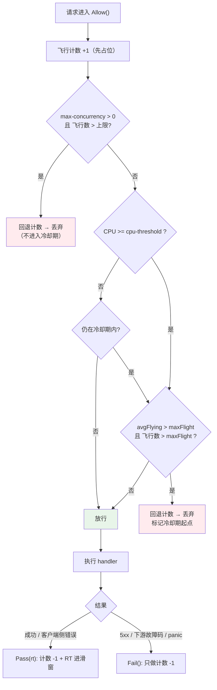

# 自适应降载

## 概述

`middleware` 包提供自适应降载（load shedding）实现，在服务端自身过载时主动丢弃请求，保住剩余请求的成功率与延迟。它是服务端保护链的第二环：

```
限流（配额） → 降载（过载自保） → 熔断（下游故障）
```

三者触发条件完全不同，不能互相替代：限流按 key 判「你超了你的额度」，降载按进程负载判「我现在扛不住了」，熔断按下游响应判「依赖已经坏了」。

降载判定只用三个本地信号，**不走 Redis**：降载的全部价值是在过载时以最低代价做出决定，一次网络往返就把这个价值抵消掉了。

| 信号 | 来源 | 回答的问题 |
|------|------|-----------|
| CPU 使用率 | 进程级采样器（cgroup / rusage） | 系统是不是真的吃紧 |
| 飞行请求数 | `atomic.Int64` + EWMA | 当前堆积了多少未完成请求 |
| 响应时间滑窗 | 固定内存环形桶 | 这台实例的处理能力上限是多少 |

组合方式参考 go-zero 自适应降载的核心思想（CPU 阈值 + 飞行请求数 + 通过量滑窗），按本仓库风格重新实现：状态全原子、热路径无锁、拒绝路径零分配，与 [熔断器](./BREAKER.md) 的性能取向一致。

HTTP 与 gRPC 共用**同一个** `Shedder` 实例与同一套信号——两侧请求消耗的是同一份 CPU，统计必须合在一起才有意义。

> 源码：[middleware/shedder.go](../middleware/shedder.go)、[middleware/shedder_window.go](../middleware/shedder_window.go)、[middleware/shedder_cpu.go](../middleware/shedder_cpu.go)、[middleware/shedder_config.go](../middleware/shedder_config.go)、[middleware/shedder_metrics.go](../middleware/shedder_metrics.go)

## 判定模型



自适应判定的两个条件**必须同时成立**，缺一不可：

- **只看 CPU 不行**：计算密集但吞吐正常的服务会被误杀，CPU 跑到 90% 本身不是问题，只要请求还在以它的最佳吞吐被处理，就不该丢。
- **只看飞行请求数不行**：IO 密集型服务（长轮询、慢下游、大查询）天然堆积大量飞行请求而 CPU 很低，此时丢请求纯属自残。这是本实现坚持把 CPU 作为前置条件的根本原因，也是 CPU 信号不可用时自适应判定整体静默的原因。

> 源码：[shedder.go:shouldDrop()](../middleware/shedder.go#L291)

## 三个信号的实现

### 信号一：CPU 使用率

进程级单例采样器，每 250ms 采一次，EWMA 系数 0.95（约 1s 量级的响应时间）；热路径只做一次 `atomic.Int64` 读取。采样协程随进程生命周期存在，网关热加载会重建降载器但复用同一个采样器，协程不会累积。

使用率的分子是「累计消耗的 CPU 时间」，分母是「本进程实际可用的核数」，结果为千分比（0–1000）。

> 源码：[shedder_cpu.go:startCPUSampler()](../middleware/shedder_cpu.go#L80)、[shedder_cpu.go:cpuSampler.loop()](../middleware/shedder_cpu.go#L116)

```go
// 返回最近一次采样值与「当前平台是否支持采样」
func CPUUsage() (int64, bool)
// 返回数据来源标识：cgroup2 / cgroup1 / procstat / rusage / unsupported
func CPUUsageSource() string
```

`runtime` 包拿不到 CPU 使用率，容器里更是必须读 cgroup（否则分母会取成宿主机核数，配额 1 核的容器永远算不到 90%）。各平台实现按构建标签分文件：

| 平台 | 来源标识 | 分子 | 分母 | 源码 |
|------|---------|------|------|------|
| Linux，cgroup v2 | `cgroup2` | `/sys/fs/cgroup/cpu.stat` 的 `usage_usec` | `/sys/fs/cgroup/cpu.max` 的 quota/period | [shedder_cpu_linux.go](../middleware/shedder_cpu_linux.go#L63) |
| Linux，cgroup v1 | `cgroup1` | `cpuacct.usage`（纳秒） | `cpu.cfs_quota_us / cpu.cfs_period_us` | 同上 |
| Linux，无 cgroup | `procstat` | `/proc/stat` 首行 `total - idle - iowait` | `runtime.NumCPU()` | 同上 |
| darwin / *BSD | `rusage` | `getrusage(RUSAGE_SELF)` 的 utime+stime | `runtime.NumCPU()` | [shedder_cpu_rusage.go](../middleware/shedder_cpu_rusage.go) |
| 其余（windows 等） | `unsupported` | — | — | [shedder_cpu_unsupported.go](../middleware/shedder_cpu_unsupported.go) |

实现细节与取舍：

- **三级回落的顺序即优先级**：cgroup v2 → cgroup v1（两种常见挂载布局 `/sys/fs/cgroup/cpuacct/` 与 `/sys/fs/cgroup/cpu,cpuacct/` 都试）→ `/proc/stat`。每一级在构造时先真读一次，读失败才降到下一级。
- **容器里固定路径够用**：Docker / containerd / k8s 默认开启 cgroup namespace，进程自己的 cgroup 就挂在 `/sys/fs/cgroup` 根上，不需要先解析 `/proc/self/cgroup`。
- **`cpuset` 不用单独解析**：Linux 上 `runtime.NumCPU()` 取的是 `sched_getaffinity` 的结果，已经反映了 cpuset 限制。
- **`/proc/stat` 扣掉 `iowait`**：等 IO 期间 CPU 其实是空闲的，计入会高估使用率；jiffy 按 `USER_HZ=100` 换算成纳秒。
- **`/proc/stat` 是明确的精度损失**：它统计的是整机使用率，同宿主机上别的容器把 CPU 打满也会让本服务开始降载。来源标识会写进启动日志与 `gateway_shedder_*` 指标，便于排查。
- **darwin / BSD 口径不同但方向一致**：这些平台没有 cgroup，整机 CPU 时间也拿不到（darwin 要走 Mach 的 `host_processor_info`，需要 cgo 或三方库，与零依赖约束冲突），因此退化为「本进程消耗 ÷ 本机核数」。单进程容器里与 Linux 的 cgroup 口径几乎重合；在开发机上它反而更合适——网关自己没吃 CPU 就不该降载，不会被编译、浏览器带跑偏。
- **读不到就当健康，不 panic**：`CPUUsage()` 第二个返回值为 `false` 时使用率恒为 0，调用方必须按「没有这个信号」处理而不是「CPU 空闲」。此时自适应判定整体静默，只保留 `max-concurrency` 硬上限。这是刻意选择的失败方向：最坏情况是降载不起作用（还有限流与熔断兜着），而反过来假设过载会在一个完全健康的进程上凭空开始丢流量。

### 信号二：飞行请求数

```go
inFlight  atomic.Int64  // 瞬时飞行请求数
avgFlying atomic.Uint64 // EWMA，存 float64 位模式
```

- **先占位再判定**：`Allow()` 先 `inFlight.Add(1)` 再做判定，被拒绝时回退。直接 `Load` 后判断会让多个 goroutine 同时看到「还有余量」从而冲破硬上限；代价是一次多余的原子加减，换来 `max-concurrency` 是真正的上限。
- **回退走裸 `Add(-1)`**：被降载拒绝的请求不参与 EWMA，否则拒绝本身会把平滑值压低。
- **EWMA 只在请求结束时更新**（`avg = avg*beta + flying*(1-beta)`，`beta` 默认 0.9）：在入口更新会把还没开始执行的请求算进去，让曲线跟着瞬时流量抖动。只在出口更新使 `avgFlying` 比 `inFlight` 略微滞后，于是流量陡增时它涨得慢（多收一些请求），陡降时落得慢（少收一些请求），整体更稳。
- **EWMA 的写入是良性竞争**：`Load` / 计算 / `Store` 之间并发结束的请求可能互相覆盖一次更新，对一个本就用来平滑的指数移动平均没有实际影响，换来的是热路径无锁。
- **记账必须配平**：`Allow()` 返回 `true` 后必须恰好调用一次 `Pass` 或 `Fail`，否则飞行计数永久偏高，降载器会越来越倾向于丢请求。三个适配层都用 `defer` 保证这一点，**连 handler panic 也不漏**。`settle()` 另有一层兜底：计数被带到负数时 CAS 纠回 0。

> 源码：[shedder.go:settle()](../middleware/shedder.go#L275)

### 信号三：响应时间滑窗

固定内存环形桶，读写全原子无锁，**不存在按请求增长的切片**：

```go
type shedderBucket struct {
    epoch atomic.Int64 // 时间片序号，-1 表示从未写入
    pass  atomic.Int64 // 通过的请求数
    rtSum atomic.Int64 // 响应时间累加，微秒
}
```

默认 `window-ms: 5000` / `window-buckets: 50`，即 50 个桶、单桶 100ms，内存恒定在 1KB 量级，与流量无关。

- **用 epoch 替代定时清零**：桶序号为 `elapsed / interval`，桶下标为 `epoch % len(buckets)`。桶被复用到新时间片时，由第一个写入者 CAS 抢到清零权，省掉一个后台清理协程。
- **已知且有界的误差**：抢到 CAS 的 goroutine 先置 `epoch` 再清零计数，若另一个 goroutine 恰好在这两步之间完成 `Add`，它那一次样本会被清掉。最坏情况是每次桶轮转（每 100ms 一次）丢失少量样本，对「最大通过量 / 最小平均 RT」这种统计量没有实际影响。
- **时间基准是单调时钟**：窗口记录构造时的 `time.Time` 并用 `Sub` 计算，走的是 Go 的单调读数，不受 NTP 回拨影响，同时便于测试传入自定义 `now`。
- **聚合跳过三类桶**：从未写入的（`epoch < 0`）、当前正在写入的（`epoch >= current`）、已滚出窗口的（`epoch < current-len+1`）。跳过当前桶是必须的——它只累积了一部分时间，通过量必然偏低，参与聚合会让容量估计被低估、进而误判过载。此外还有一层 `epoch % len == index` 的对齐校验，兜住极端时钟跳变造成的别名读取。

```go
type shedderWindowStat struct {
    MaxPass int64 // 单桶最大通过量
    MinRT   int64 // 各桶平均响应时间的最小值，微秒；0 表示窗口内无样本
}
```

> 源码：[shedder_window.go:record()](../middleware/shedder_window.go#L99)、[shedder_window.go:stat()](../middleware/shedder_window.go#L139)

### 承载上限 maxFlight

三个信号在这里汇成一个数：

```
最大吞吐 = 单桶最大通过量 × 每秒桶数
承载上限 = 最大吞吐 × 最小平均响应时间        （Little 定律：并发 = 吞吐 × 驻留时间）
```

取「最大通过量」与「最小平均 RT」而不是各自的平均值，是为了估出**系统状态最好时**的能力：这两个值描述的是「这台实例确实做到过的吞吐」与「它确实达到过的最低延迟」，二者相乘就是它曾经稳定承载过的并发量。超过这个数，就说明请求在排队而不是在被处理。

下界取 1，避免滑窗还没有样本（刚启动、或前一轮全是失败请求）时把上限算成 0 而全盘拒绝。

举例：单桶最大通过 20 次、每秒 10 个桶 → 最大吞吐 200 QPS；最小平均 RT 50ms → 承载上限 = 200 × 0.05 = **10**。此时即使 CPU 到了 95%，只要飞行请求数不超过 10，就不丢任何请求。

> 源码：[shedder.go:maxFlight()](../middleware/shedder.go#L389)

## 冷却 / 恢复机制

CPU 使用率是 250ms 采样 + EWMA 的**滞后信号**。一旦开始丢请求，负载下降会先反映在飞行请求数上，过几百毫秒才反映到 CPU 上。如果没有冷却，就会出现这样的高频抖动：

```
丢弃 → CPU 回落 → 全部放行 → 立刻又堆积 → 丢弃 → ...
```

客户端看到的是成功与 503 交替出现，而它的重试又会不断把流量打回来。

冷却机制的实现：

- 每次发生自适应丢弃时记录一个时间点（`markDropped`，单调时钟相对偏移）并置 `hot` 标志。
- 在 `cooldown-ms`（默认 1000ms）内，**CPU 条件视为仍然成立**（`stillHot` 返回 `true`），即使 CPU 已经回落到阈值以下。
- **但承载上限条件仍要单独满足**。这一点很关键：冷却不等于「无脑拒绝一整秒」，负载真的退潮（`avgFlying` 降到承载上限以下）时会立刻恢复放行。
- 冷却从**最近一次**丢弃起算：冷却期内再次丢弃会把计时重置，因此持续过载时冷却会持续顺延，过载结束后再等一个完整的冷却窗口才彻底退出。
- 冷却期过后 `stillHot` 自行把 `hot` 置回 `false`，不需要后台协程做超时清理。

`max-concurrency` 硬上限触发的丢弃**不进入冷却期**：硬上限本身是自限的（飞行数降下来就自然放行），把它和自适应判定的冷却状态耦合只会让两套语义互相干扰。

> 源码：[shedder.go:stillHot()](../middleware/shedder.go#L336)、[shedder.go:markDropped()](../middleware/shedder.go#L350)

## 硬并发上限（max-concurrency）

除自适应判定外还有一层确定性保护：飞行请求数超过 `max-concurrency` 直接拒绝。

- 默认 `0` = 关闭。
- **平台无关**：不依赖 CPU 信号，是 darwin / windows 上唯一仍然有效的那条保护。
- **确定性**：不需要压测调参，语义就是一个舱壁（bulkhead）。
- 判定在自适应判定之前，命中后不进入冷却期。

纯流式服务（见下文「Stream 的判定粒度」）拿不到自适应信号，应当依赖这一项。

## Shedder — 核心降载器

> 源码：[middleware/shedder.go:Shedder](../middleware/shedder.go#L75)

```go
type Shedder struct {
    // 不变配置（构造后只读）
    cpuThreshold   int64         // CPU 阈值，千分比
    maxConcurrency int64         // 硬并发上限，0 表示不限
    cooldown       time.Duration // 冷却时长
    fallbackRTMcs  int64         // 滑窗无样本时的兜底 RT，微秒
    flyingBeta     float64       // 飞行请求数 EWMA 系数
    cpuUsageFn     func() (int64, bool)
    window         *shedderWindow
    bucketsPerSec  float64
    start          time.Time     // 时间基准（带单调读数）

    // 运行时状态（全原子）
    inFlight  atomic.Int64  // 当前飞行请求数
    avgFlying atomic.Uint64 // 飞行请求数的 EWMA，存 float64 位模式
    hot       atomic.Bool   // 是否处于降载冷却期
    droppedAt atomic.Int64  // 最近一次丢弃距 start 的纳秒数
    total     atomic.Int64  // 累计判定次数
    dropped   atomic.Int64  // 累计丢弃次数
}
```

### 创建

```go
// CPU 信号取自进程级采样器
func NewShedder(cfg *shedderconfig.Shedder) *Shedder
// 指定 CPU 使用率来源（测试，或接入监控 agent 推下来的使用率）
func NewShedderWithCPUFunc(cfg *shedderconfig.Shedder, cpuUsageFn func() (int64, bool)) *Shedder
```

配置类型是 go-config 的 `shedderconfig.Shedder`（`github.com/kamalyes/go-rpc-gateway/config/shedder`），详见下面的[配置](#配置)小节。

`cfg` 为 `nil` 时取 `shedderconfig.Default()`；非法字段一律回落默认而不是报错——一份写错的降载配置不该让网关起不来。归一化返回的是配置副本，不会改写传进来的那一份（传进来的通常就是 `cfg.Middleware.Shedder` 本身，就地改写会把回落后的值写回全局配置树）。`cpuUsageFn` 为 `nil` 时按「不支持采样」处理。

> 源码：[shedder.go:NewShedder()](../middleware/shedder.go#L99)、[shedder_config.go:normalizeShedderConfig()](../middleware/shedder_config.go#L61)

### 核心方法

| 方法 | 说明 | 源码 |
|------|------|------|
| `Allow() bool` | 一元请求放行判定；返回 `true` 后必须调用一次 `Pass` 或 `Fail` | [shedder.go:L150](../middleware/shedder.go#L150) |
| `AllowStream() bool` | 建流判定；不占用飞行计数、不产生 RT 样本 | [shedder.go:L206](../middleware/shedder.go#L206) |
| `Pass(rt time.Duration)` | 正常完成：归还飞行计数 + RT 进滑窗 | [shedder.go:L232](../middleware/shedder.go#L232) |
| `Fail()` | 异常结束：只归还飞行计数，不进滑窗 | [shedder.go:L255](../middleware/shedder.go#L255) |
| `Shedding() bool` | 当前是否处于降载冷却期 | [shedder.go:L416](../middleware/shedder.go#L416) |
| `InFlight() int64` | 当前飞行请求数 | [shedder.go:L423](../middleware/shedder.go#L423) |
| `Snapshot() ShedderSnapshot` | 强类型快照（用于指标采集） | [shedder.go:L448](../middleware/shedder.go#L448) |
| `Reset()` | 重置运行时状态（配置不变） | [shedder.go:L475](../middleware/shedder.go#L475) |

**失败请求为什么不进滑窗**：滑窗要估的是「系统健康时能稳定承载多少并发」。把超时、500 这些样本混进去会同时抬高 RT、抬高通过量，算出一个系统根本达不到的承载上限，反过来让降载在真正该动手的时候不动手。

`Reset()` 会一并清零飞行计数，因此只应在没有在途请求时调用（测试、热加载后）。

### ShedderSnapshot — 强类型快照

> 源码：[middleware/shedder.go:ShedderSnapshot](../middleware/shedder.go#L430)

```go
type ShedderSnapshot struct {
    Shedding        bool    // 是否处于降载冷却期
    CPUUsage        int64   // CPU 使用率千分比；CPUSupported 为 false 时无意义
    CPUSupported    bool    // 当前平台是否支持 CPU 采样
    CPUThreshold    int64   // CPU 阈值千分比
    InFlight        int64   // 当前飞行请求数
    AvgFlying       float64 // 飞行请求数的 EWMA
    MaxFlight       float64 // 滑窗估出的承载上限
    MaxPass         int64   // 滑窗内单桶最大通过量
    MinRTMicros     int64   // 滑窗内最小平均响应时间，微秒；0 表示无样本
    MaxConcurrency  int64   // 硬并发上限，0 表示不限
    TotalRequests   int64   // 累计判定次数
    DroppedRequests int64   // 累计丢弃次数
}
```

## ShedderManager — 降载管理器

> 源码：[middleware/shedder.go:ShedderManager](../middleware/shedder.go#L516)

```go
func NewShedderManager(cfg *shedderconfig.Shedder) *ShedderManager
func (m *ShedderManager) Shedder() *Shedder
func (m *ShedderManager) Config() *shedderconfig.Shedder // 已补齐默认值的生效配置（副本）
func (m *ShedderManager) IsPathProtected(path string) bool
func (m *ShedderManager) Snapshot() ShedderSnapshot
func (m *ShedderManager) Reset()
```

所有方法对 `nil` 接收者安全。

### 与 BreakerManager 的两处刻意差异

**1. 进程唯一实例，不按路径拆分。**

`BreakerManager` 是「每个 key 一个断路器」，`ShedderManager` 只持有一个 `Shedder`。因为降载依赖的 CPU 使用率与飞行请求数都是**进程级**信号，拆成每路径一份既拿不到更细的信号，还会让每条路径各自按同一份 CPU 读数独立判定，等于把阈值放大了 N 倍——N 条路径各用 1/N 的容量时，整个进程已经满载，但没有任何一条路径认为自己该降载。

**2. 路径策略是黑名单，不是白名单。**

| | 熔断 | 降载 |
|---|------|------|
| 配置项 | `prevention-paths`（白名单）+ `exclude-paths`（精确匹配） | `exclude-paths`（黑名单，前缀匹配） |
| 默认行为 | 只保护明确列出的路径 | 保护全部流量 |

过载是全进程现象，漏保护一条高流量路径就等于没有保护；而必须永远可达的端点数量有限、可以穷举，正适合做排除。排除按**前缀**匹配（熔断的 exclude 是精确 map 查找），因为 `/debug/pprof/heap` 这类子路径必须能被 `/debug` 一条规则覆盖。列表长度是个位数且构造时固定，线性扫描比 map 查找更快也更省内存。

默认排除 `/health`、`/healthz`、`/readyz`、`/livez`、`/metrics`、`/debug`：

- 健康检查被降载会让编排系统在服务过载时直接重启或摘流，把一次本可自愈的过载变成一次重启风暴。
- 指标端点被降载会让过载期间恰好拿不到任何指标——正是最需要指标的时候。

gRPC 侧排除规则按方法全名（形如 `/user.v1.UserService/GetUser`）前缀匹配，因此默认的 HTTP 风格前缀不会误伤任何 gRPC 方法；要排除某个服务的全部方法，配 `/user.v1.UserService/` 即可。

## ShedderHTTPMiddleware — HTTP 中间件

> 源码：[middleware/shedder.go:ShedderHTTPMiddleware()](../middleware/shedder.go#L622)

```go
func ShedderHTTPMiddleware(manager *ShedderManager) func(http.Handler) http.Handler
```

`manager` 为 `nil` 或路径被排除时直通，不占用飞行计数。

被降载时的响应（预分配响应体，零分配）：

```http
HTTP/1.1 503 Service Unavailable
Content-Type: application/json
Retry-After: 1

{"code":503,"message":"Service overloaded (load shedding)","success":false}
```

`Retry-After` 取 1 秒而不是更长：降载保护的是秒级自愈的瞬时过载，等太久等于把一次抖动变成一次故障。它是固定字符串常量，避免每次拒绝都做一次整数格式化。

放行后的记账：

- 用 `NewResponseWriter` 捕获状态码，`rw.IsServerError()`（5xx）记 `Fail()`，其余记 `Pass(时长)`。
- 记账写在 `defer` 里而不是 `ServeHTTP` 之后：handler panic 时若不归还飞行计数，这个计数会永久偏高，几次 panic 就能让降载器把全部流量当成过载丢掉。
- panic 路径按 `Fail()` 记（只归还计数、不进滑窗），并且**不做 `recover`**——recover 后再 panic 会污染最外层 `RecoveryMiddleware` 看到的调用栈，得不偿失。实现用一个 `completed` 布尔标记区分正常返回与 panic。

## gRPC 拦截器

> 源码：[shedder.go:UnaryServerShedderInterceptor()](../middleware/shedder.go#L733)、[shedder.go:StreamServerShedderInterceptor()](../middleware/shedder.go#L773)

```go
func UnaryServerShedderInterceptor(manager *ShedderManager) grpc.UnaryServerInterceptor
func StreamServerShedderInterceptor(manager *ShedderManager) grpc.StreamServerInterceptor
```

`manager` 为 `nil` 或方法被排除时直通。被降载时返回预构建的错误，不执行 handler，**也不打日志**——降载期间每条拒绝都打日志只会在最需要日志的时候把日志刷爆。

### 失败判定复用熔断的分类器

```go
func recordShedderResult(s *Shedder, err error, rt time.Duration) {
    if IsBreakerFailureCode(status.Code(err)) {
        s.Fail()
        return
    }
    s.Pass(rt)
}
```

直接复用 [`IsBreakerFailureCode`](./BREAKER.md#失败判定表)：两者需要回答的是同一个问题——「这次调用是服务端真的坏了，还是调用方自己的问题」。判定口径与 HTTP 侧的 `rw.IsServerError()` 一致（都等价于 5xx）：

| 分类 | gRPC code | 降载记账 |
|------|-----------|---------|
| 下游故障 | `Unknown`、`DeadlineExceeded`、`Internal`、`Unavailable`、`DataLoss` | `Fail()`，不进滑窗 |
| 客户端侧问题 / 正常响应 | `OK`、`Canceled`、`InvalidArgument`、`NotFound`、`AlreadyExists`、`PermissionDenied`、`Unauthenticated`、`ResourceExhausted`、`FailedPrecondition`、`Aborted`、`OutOfRange`、`Unimplemented` | `Pass(rt)`，进滑窗 |

客户端侧错误计入滑窗是对的：服务端正常工作并给出了答案，这是一次有效的容量样本。

### Stream 的判定粒度

Stream 拦截器只在**建流时**判定一次（与限流、熔断的 Stream 粒度一致），并且走 `AllowStream()`：**流不占用飞行计数，也不产生 RT 样本**。

理由：承载上限由「最大通过量 × 最小平均 RT」估出，而一条长连接流的生命周期与它消耗的资源无关。一条挂一小时的流会把飞行计数钉死在高位，让 `maxFlight` 估计彻底失效，最后把一元请求连带全部丢掉。因此流只**借用**一元流量估出的容量来回答「现在能不能再建一条流」，不反向污染这个估计。

代价是明确的：纯流式服务拿不到自适应信号，这类服务应改用 `max-concurrency` 硬上限。好处是建流被拒绝时不改变任何飞行计数，长连接期间也不存在计数泄漏。

## 降载拒绝时返回的错误

```go
var shedderDropGRPCErr = errors.NewError(errors.ErrCodeServiceOverloaded, "").ToGRPCError()
```

新增错误码 `ErrCodeServiceOverloaded(4005)`，三态映射（登记见 [错误体系](./ERRORS.md#三态映射)）：

| ErrorCode | HTTP Status | Proto StatusCode | gRPC Code | Message |
|-----------|-------------|------------------|-----------|---------|
| `ErrCodeServiceOverloaded(4005)` | 503 | `Unavailable` | `Unavailable` | `Service overloaded` |

与 `ErrCodeServiceDegraded(4004)` 区分开：后者表示「功能降级后仍在服务」，前者表示「这一次请求根本没有被处理」，调用方应带退避重试而不是降级消费结果。

和熔断一样，不走 `errors.ToGRPCError(ctx, bizCode)` 的 i18n 路径——那条路径是给各微服务注册的业务错误码用的，降载拒绝是框架层决定，也不该在过载时再付一次翻译查表的代价。

### 为什么是 Unavailable 而不是 ResourceExhausted

1. **两侧状态码必须一致**。grpc-gateway 把 `ResourceExhausted` 映射成 HTTP 429，而降载语义是「服务端自己忙不过来」，不是「调用方超了配额」。429 会让调用方去查自己的限额而不是退避，还会造成 HTTP 直连拿到 503、经 gateway 代理拿到 429 的分裂。
2. **`Unavailable` 对调用方是正确的指引**。gRPC 规范里 `Unavailable` 明确是「瞬时不可用，应带退避重试」，`ResourceExhausted` 指向配额而非容量。
3. **被下游熔断器观测到是期望行为而非隐患**。调用方的熔断器因为一个过载的服务打开，正是要的**负反馈**（上游退避 → 本进程过载缓解）。真正要避免的**正反馈**是「自己的拒绝被自己的熔断器计为下游故障」——那是靠拦截器链顺序解决的，见下一节。

## 拦截器链位置

### 顺序

HTTP 链（`Manager.GetMiddlewares`）：

```
… → ⑦ 限流 → ⑦.5 降载 → ⑧ 熔断 → ⑨ 安全头 → …
```

gRPC 链（`server/grpc.go`，Unary 与 Stream 一致）：

```
链路追踪 → 请求上下文 → 日志 → i18n → 监控 → 限流 → 降载 → 熔断 → struct-tag 校验 → 压缩
```

### 为什么必须在限流之后

限流是确定性的配额判定，被它拒绝的请求根本不会触达 handler。把降载放在限流内层，这些请求：

- 不会占用降载的飞行计数（否则被限流拒绝的那一瞬间飞行数虚高）；
- 不会把「拒绝得极快」的响应时间掺进 RT 滑窗。这一点影响更大：滑窗取的是**最小**平均 RT，一批微秒级的限流拒绝会把 `minRT` 压到接近 0，承载上限随之被低估，降载反而会在系统其实还有余量时就开始丢请求。

语义上也该如此：一个超了配额的客户端应该拿到 429，无论进程当时是否过载。

### 为什么必须在熔断之外（熔断在降载内层）

这是本次实现最关键的一处顺序约束。降载拒绝返回 `codes.Unavailable`，而 `Unavailable` **恰好在 `IsBreakerFailureCode` 的失败集合里**。如果降载挂在熔断内层：

```
熔断（外） → 降载（内）        ← 错误的顺序
```

熔断器就会把降载的自我保护拒绝当成下游故障，形成：

```
流量过载 → 降载拒绝(Unavailable) → 熔断计为失败 → 熔断打开 → 全部请求被拒
```

而且熔断是**按路径**的，一次全局过载会把所有被保护路径的断路器一起打开；更糟的是负载退潮后仍要等熔断的 `timeout`（默认 30s）走完才能恢复，远长于降载自己 1s 的冷却。

顺序反过来后，本进程的熔断器永远观测不到降载拒绝：

```
降载（外） → 熔断（内）        ← 当前实现
```

这与熔断自己刻意放在限流之后、避免把限流的 `ResourceExhausted` 当成下游故障，是同一类考虑。

### 为什么降载比熔断更该早拒绝

- 降载回答「本进程还扛不扛得住」，是**全局自保**，应当尽早拒绝，少做一层就少烧一点 CPU。
- 熔断回答「下游还活着吗」，需要尽量**贴近 handler** 才能观测到真实健康度。

两者的位置要求本身就是相反的，当前顺序同时满足。

## 与限流、熔断的相互作用

| 关系 | 分析 |
|------|------|
| 限流 → 降载 | 限流的 `ResourceExhausted`/429 不经过降载，不污染飞行计数与 RT 滑窗（见上文）。 |
| 降载 → 熔断（同进程） | 熔断在内层，永远观测不到降载的 `Unavailable`，不存在正反馈。 |
| 熔断 → 降载（同进程） | 熔断打开时的快速 `Unavailable` 会被降载记为 `Fail()`（`Unavailable` 在失败集合里），因此**不进 RT 滑窗**，不会把 `minRT` 压低。这是复用 `IsBreakerFailureCode` 的一个额外收益。 |
| 降载 → 调用方熔断（跨进程） | 调用方熔断器观测到 `Unavailable` 而打开，是期望的负反馈：上游退避让本进程的过载更快缓解。 |
| 降载 ↔ HTTP 层熔断（经 grpc-gateway） | HTTP 链的降载在 HTTP 熔断之外，HTTP 熔断看不到它。但 gRPC 侧降载返回的 `Unavailable` 经 grpc-gateway 变成 503 后，会被 HTTP 链的熔断记为失败——这与「gRPC 熔断打开 → 503 → HTTP 熔断记失败」的既有行为一致：从网关视角看，后端确实在返回 5xx。需要避免时把该路径加入熔断的 `exclude-paths`。 |
| 降载 ↔ 降载（HTTP / gRPC 两侧） | 共用同一个 `Shedder` 实例，信号合并统计，不会互相加倍。 |

## 指标

未启用降载时**不注册**采集器，注册表里连指标名都不会出现，而不是导出一组恒为 0 的时间序列。采集函数在 Prometheus scrape 时按需调用，没有后台轮询协程。

```go
func (mm *MetricsManager) RegisterShedderCollector(statFn func() *ShedderStat) error
```

重复注册返回 `prometheus.AlreadyRegisteredError` 而不是 panic，热加载可以安全重入。

| 指标 | 类型 | 说明 |
|------|------|------|
| `gateway_shedder_shedding` | Gauge | 是否处于降载状态（1 / 0） |
| `gateway_shedder_cpu_permille` | Gauge | 观测到的 CPU 使用率（千分比）；**平台不支持采样时不导出此指标** |
| `gateway_shedder_cpu_supported` | Gauge | 当前平台是否支持 CPU 采样（0 表示自适应判定静默） |
| `gateway_shedder_cpu_threshold_permille` | Gauge | 配置的 CPU 阈值（千分比） |
| `gateway_shedder_in_flight` | Gauge | 当前飞行请求数 |
| `gateway_shedder_avg_flying` | Gauge | 飞行请求数的 EWMA |
| `gateway_shedder_max_flight` | Gauge | 滑窗估出的承载上限 |
| `gateway_shedder_window_max_pass` | Gauge | 滑窗内单桶最大通过量 |
| `gateway_shedder_window_min_rt_microseconds` | Gauge | 滑窗内最小平均响应时间（微秒，0 表示无样本） |
| `gateway_shedder_max_concurrency` | Gauge | 配置的硬并发上限（0 表示不限） |
| `gateway_shedder_requests_total` | Counter | 累计判定的请求数 |
| `gateway_shedder_dropped_total` | Counter | 累计丢弃的请求数 |

所有指标**不带 label**：降载器是进程唯一实例，加一个恒为同一值的标签只会凭空抬高指标基数。

CPU 不可采样时刻意不导出使用率：导出一个 0 会被读成「CPU 空闲」，而真实含义是「这个平台没有这个信号」——后者由 `gateway_shedder_cpu_supported` 单独表达。

注入位置：[server/middleware_init.go:injectMetricsCollectors()](../server/middleware_init.go#L94)，与熔断的 `SetBreakerStatsFn` 在同一处。

> 源码：[middleware/shedder_metrics.go](../middleware/shedder_metrics.go)

## 配置

配置类型定义在 `go-config` 的 `pkg/shedder`（`shedderconfig.Shedder`，`go-config >= v0.25.1`），与熔断配置下沉到 `pkg/breaker` 的惯例一致。本仓库不再自带一份同构类型，`Manager` 直接读 `cfg.Middleware.Shedder`（[middleware/manager.go](../middleware/manager.go#L117)）。

```yaml
middleware:
  shedder:
    enabled: true           # 默认 false，必须显式开启
    module-name: shedder    # 模块名称
    cpu-threshold: 900      # CPU 使用率阈值，千分比 0-1000
    max-concurrency: 0      # 硬并发上限，0 表示不限
    window-ms: 5000         # 响应时间滑窗总长度，毫秒
    window-buckets: 50      # 滑窗桶数，5000/50 = 每桶 100ms
    cooldown-ms: 1000       # 降载冷却时长，毫秒
    min-rt-ms: 1000         # 滑窗无样本时的兜底响应时间，毫秒
    flying-beta: 0.9        # 飞行请求数 EWMA 平滑系数，取值 (0,1)
    exclude-paths:
      - "/health"
      - "/metrics"
      - "/debug"
```

`enabled` 为 `false`（默认）或整棵 `middleware.shedder` 子树缺失时，`Manager` 不会创建 `ShedderManager`，HTTP 中间件退化为直通、gRPC 拦截器返回 `nil`，调用路径上不留下任何判断。

| 字段 | 类型 | 默认值 | 说明 |
|------|------|--------|------|
| `module-name` | string | `shedder` | 模块名称 |
| `enabled` | bool | `false` | 是否启用降载 |
| `cpu-threshold` | int64 | `900` | CPU 使用率阈值，千分比；超出 (0,1000] 回落默认 |
| `max-concurrency` | int64 | `0` | 硬并发上限，0 表示不限 |
| `window-ms` | int64 | `5000` | 响应时间滑窗总长度，毫秒 |
| `window-buckets` | int | `50` | 滑窗桶数；超过 `window-ms` 时截到 `window-ms`（保证单桶至少 1ms） |
| `cooldown-ms` | int64 | `1000` | 降载冷却时长，毫秒 |
| `min-rt-ms` | int64 | `1000` | 滑窗无样本时的兜底响应时间，毫秒 |
| `flying-beta` | float64 | `0.9` | 飞行请求数 EWMA 系数；不在 (0,1) 内回落默认 |
| `exclude-paths` | []string | `/health` `/healthz` `/readyz` `/livez` `/metrics` `/debug` | 排除的路径，前缀匹配 |

两点与熔断配置的差异：

- **时间字段带 `-ms` 后缀、单位是毫秒**，不沿用熔断 `timeout` 的「int64 纳秒」写法：纳秒值写进 YAML 只能是 `5000000000` 这种数字，既不可读也容易误配成秒。
- **`enabled` 默认 `false`**（熔断默认 `true`）：降载会在服务还能响应的时候主动丢请求，阈值要结合容量压测结果调，默认开启等于替使用方做了一个会丢流量的决定；熔断只在下游已经坏掉时才动手，默认开启是安全的。

YAML 的解码由 go-config 自己完成（`mapstructure` 标签），本仓库侧只保留两件 go-config 没有、也不该有的事（[middleware/shedder_config.go](../middleware/shedder_config.go)）：

| 本仓库保留的 | 作用 |
|------|------|
| `normalizeShedderConfig(cfg)` | 非法值回落默认，返回副本；桶数超过 `window-ms` 时截到 `window-ms`，`flying-beta` 不在 (0,1) 时回落 0.9 |
| `shedderWindowSpan` / `shedderCooldown` / `shedderMinRT` | 三个 `-ms` 字段到 `time.Duration` 的换算 |

这些约束（桶数上限、beta 区间）由本仓库的降载算法决定，配置库不该知道消费方的内部约束，否则换一种算法的使用方也会被绑住。

**热加载行为**：`Manager.UpdateConfig` 走的是重建路径（`NewManager`），因此配置热加载会换成一个全新的 `Shedder`，滑窗样本、飞行计数与冷却状态一并清零（与熔断器热加载后状态重置一致）。重建瞬间仍在途的请求持有的是旧实例，`Pass`/`Fail` 记在旧实例上，不会把新实例的飞行计数带成负数。CPU 采样器是进程级单例，热加载时复用，不会重复起协程。

## 通过 Manager 使用

`Manager` 在 `NewManager` 中按配置创建共享的 `shedderManager`，HTTP 与 gRPC 复用同一个实例：

```go
// HTTP 中间件（未启用时返回直通中间件）
func (m *Manager) ShedderMiddleware() MiddlewareFunc
// gRPC 拦截器（未启用时返回 nil）
func (m *Manager) GRPCShedderUnaryInterceptor() grpc.UnaryServerInterceptor
func (m *Manager) GRPCShedderStreamInterceptor() grpc.StreamServerInterceptor
// 供 server 包注册指标采集器
func (m *Manager) GetShedderManager() *ShedderManager
```

单独使用核心降载器（不经中间件，例如保护一段自己写的后台任务入口）：

```go
// shedderconfig 为 github.com/kamalyes/go-rpc-gateway/config/shedder
// 注意 enabled 只由 Manager 在创建 ShedderManager 时判定，直接 new 出来的降载器总是生效
shedder := middleware.NewShedder(shedderconfig.Default())

if !shedder.Allow() {
    return errors.NewError(errors.ErrCodeServiceOverloaded, "overloaded")
}
start := time.Now()
result, err := doWork()
if err != nil {
    shedder.Fail()     // 异常结束：只归还飞行计数
    return nil, err
}
shedder.Pass(time.Since(start))
return result, nil
```

## 调参建议

- **`cpu-threshold`**：容器部署建议 850–950。配额小（1 核以内）的容器 CPU 曲线更抖，取 900 以上更稳。注意分母是配额而不是宿主机核数，所以这个值就是「用掉了配额的百分之多少」。
- **`window-ms` / `window-buckets`**：窗口要覆盖至少几个 P99 RT。默认 5s / 50 桶（单桶 100ms）适合 RT 在数十毫秒量级的服务；RT 在秒级的服务应把窗口拉到 10–30s，否则单桶内样本太少，`maxPass` 估不准。
- **`min-rt-ms`**：只在滑窗没有样本时用到（刚启动、或前一轮全是失败）。它和 `maxFlight` 的下界 1 一起决定冷启动时的保守程度：值越大，初始承载上限越大、越不容易在启动瞬间误丢。
- **`cooldown-ms`**：不建议低于 CPU 采样的响应时间（约 1s），否则冷却结束时 CPU 还没反映出负载变化，抖动依旧。
- **`max-concurrency`**：建议在 darwin/windows 部署、或纯流式服务上必配。取值参考压测得到的最大稳定并发，留 1.5–2 倍余量。
- **验证手段**：盯 `gateway_shedder_max_flight` 与 `gateway_shedder_avg_flying` 两条曲线。正常情况下后者应长期低于前者；两者频繁交叉而 `gateway_shedder_dropped_total` 持续上涨，说明容量真的不够，该扩容而不是继续调降载参数。

## 下一步

- [熔断器](./BREAKER.md) — 下游故障隔离，降载的内层
- [中间件系统](./MIDDLEWARE.md) — 完整的中间件链与挂载顺序
- [错误体系](./ERRORS.md) — `ErrCodeServiceOverloaded` 的三态映射
